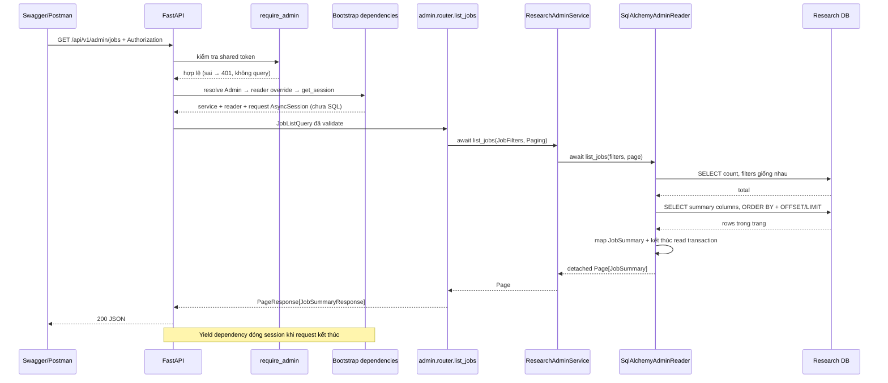
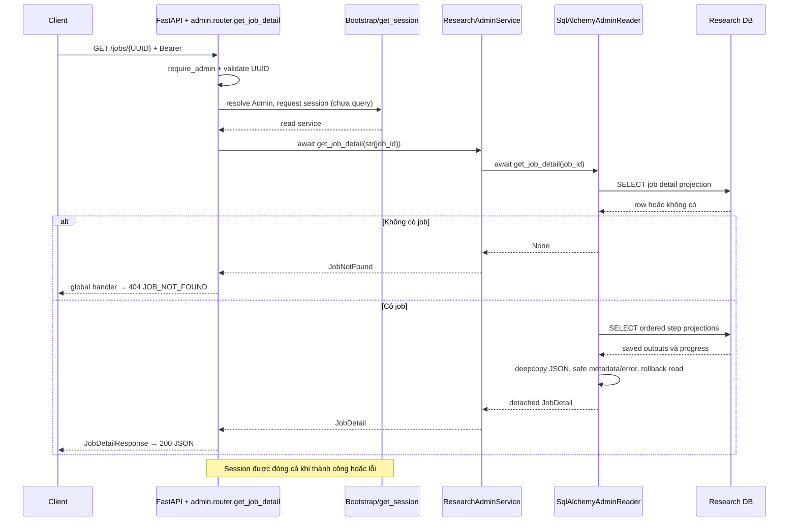

# 06 — Theo hai request từ HTTP tới DB rồi trở về

Ví dụ xuyên suốt là dữ liệu **giả định để giải thích**, không được seed vào production:
job `11111111-1111-4111-8111-111111111111`, `Công ty Sen CRM`, NEEDS_REVIEW, RESEARCH
đã hoàn thành, CLASSIFY UNKNOWN và SCORE/REPORT PENDING. Có thể thay ID bằng một job
có sẵn; DB rỗng trả trang rỗng là đúng. Không cần gọi AI để thực hành đọc.

## Luồng 1: tìm job cần xem

Request: `GET /api/v1/admin/jobs?status=NEEDS_REVIEW&company_name=Sen&limit=50`,
header `Authorization: Bearer <ADMIN_TOKEN>`. Cách encode/gửi token xem [05-api.md](05-api.md).



Các mũi tên đầu thuộc auth/resolve dependency. `Admin` trong
[dependencies.py](../../src/company_ai/api/admin/dependencies.py) yêu cầu
`get_admin_service`; function này yêu cầu `get_admin_reader`. Bootstrap override
reader contract bằng `get_sqlalchemy_admin_reader`, nhận session từ `get_session`.
Constructor không chạy SQL. FastAPI có thể resolve dependency trước validation query;
điều bảo đảm là auth và query validation hoàn tất trước lời gọi data query.

Mũi tên API→App tạo `JobFilters(status="NEEDS_REVIEW", company_name="Sen")` và
`Paging(0, 50)`, không đưa Request/Query model vào application. App→Reader đi qua
hợp đồng [ResearchAdminReader](../../src/company_ai/application/research/admin_ports.py);
object runtime thực sự là adapter SQLAlchemy. Không gọi router research để tái sử dụng HTTP.

Hai mũi tên DB lần lượt count và lấy trang. Cùng predicates, không tải input/result
của toàn bộ jobs, không query thêm từng item. `await` nhường event loop trong lúc DB
trả kết quả, không tạo Celery task. Count và page cùng scope đọc ngắn nhưng không
hứa snapshot bất biến trên mọi isolation level.

Các mũi tên về dùng dataclass detached rồi Pydantic schema trong
[router.py](../../src/company_ai/api/admin/router.py). DB lưu `input_json` và
`total_estimated_cost_usd`; JSON list chỉ trả các field sau (một trang mẫu giả định):

```json
{
  "items": [{
    "job_id": "11111111-1111-4111-8111-111111111111",
    "company_name": "Công ty Sen CRM",
    "website": "https://example.com/",
    "status": "NEEDS_REVIEW",
    "created_at": "2026-10-18T00:00:00Z",
    "updated_at": "2026-10-18T00:01:00Z",
    "completed_at": null,
    "estimated_cost_usd": 0.05,
    "error_code": "AMBIGUOUS_PROVIDER_OUTCOME"
  }],
  "total": 1,
  "offset": 0,
  "limit": 50
}
```

`total=1` là count theo filter; offset=100 có thể trả `items=[]`, total vẫn 1.
Khi debug, xem params đã encode, `JobFilters`, SQL có bind và limit, rồi total/items.
Không log token hay toàn bộ công ty input. Tie timestamp dùng ID để ổn định thứ tự.

## Luồng 2: mở detail rồi đọc lịch sử

Lấy job_id ở list, gọi `GET /api/v1/admin/jobs/{job_id}` cùng Bearer header.



Auth, resolve và validation ở sơ đồ thứ hai được nhóm để dễ đọc, không phải quy
định thứ tự gọi từng dependency; không có SQL khi khởi tạo reader. Các mũi tên
App→Reader→DB thực hiện tối đa hai SELECT. Không lock/update lease. Khi không có job,
service dùng `JobNotFound` có sẵn; handler trong [main.py](../../src/company_ai/main.py)
map 404 nhất quán. ID không hợp lệ bị 422 trước khi đọc.

Với job Sen, DB có RESEARCH.output_json, CLASSIFY UNKNOWN cùng lease/token/hash nội
bộ. JSON detail chứa input/result, steps/output, timestamps, metadata provider/model
đã lưu, error code an toàn. Nó bỏ token/hash/endpoint và thay raw error_message bằng
câu cố định. Không trả `can_retry` do API tự tính. Ví dụ **trích đoạn**, không phải
toàn bộ response schema:

```json
{
  "job_id": "11111111-1111-4111-8111-111111111111",
  "status": "NEEDS_REVIEW",
  "workflow_version": "manual-v1",
  "input": {"company_name": "Công ty Sen CRM"},
  "result": null,
  "error": {
    "code": "AMBIGUOUS_PROVIDER_OUTCOME",
    "message": "Research job stopped; inspect sanitized events and attempts."
  }
}
```

Steps đầy đủ cho phép xem RESEARCH đã có evidence gì và CLASSIFY dừng lúc nào. Với
job tavily-v1, còn có COLLECT và partial `result.collect` khi đã hoàn thành thu thập.
SCORE là deterministic; đọc steps không chạy lại score hay gọi LLM. Missing evidence
là giới hạn nguồn, không phải cam kết kết quả sai hoặc tự động đủ điều kiện retry.

Tiếp theo gọi `/jobs/{job_id}/events` và `/jobs/{job_id}/attempts` để nối timeline và
attempt theo step_id. Mỗi route vẫn có auth, filters/page và kiểm tra job tồn tại.
History đi theo `created_at ASC, id ASC`, có total độc lập; retention có thể đã xóa
events. `UNKNOWN` + null tokens không chứng minh provider chưa chạy/chưa tính phí;
ước lượng USD giữ reservation có thể khác usage cuối cùng. Không tự retry khi xem.

## Import, async và thời gian sống

Chiều gọi runtime: API → service → reader implementation → DB. Chiều import:
API và infrastructure cùng phụ thuộc application contracts; application không
import infrastructure. Bootstrap biết hai bên để binding. Đây là read side đơn giản
trong cùng research context/database, không phải event sourcing hoặc database thứ hai.

Lifespan tạo engine một lần cho app; request tạo session riêng từ engine. Depends
cache trong một request không biến session thành singleton toàn app. Hai GET liên
tiếp của job Sen có hai session khác nhau, trong khi hai nhánh dependency của cùng
request có thể dùng chung session. Adapter kết thúc read transaction trước khi trả;
DTO serialize được kể cả sau session đóng. API async nhường I/O; worker chạy workflow
khi Celery nhận task được enqueue từ create/retry hoặc lịch recovery/resume của Beat.
GET admin không enqueue task.

## Bằng chứng tích hợp

[test_admin_api.py](../../tests/integration/test_admin_api.py) gọi HTTP qua ASGI,
chạy lifespan thật và production dependency graph, chỉ override database bằng fixture
và publisher trap. SQLAlchemy đọc SQLite/PostgreSQL thật; không mock service/reader
rồi coi là E2E. Fixtures tạo job lịch sử/legacy/COLLECT, không gọi provider và không
seed production lúc startup. **20 HTTP tests passed, không skipped**, trên cả hai backend.

Tests so toàn bộ rows trước/sau các GET, bắt SQL chỉ SELECT/không FOR UPDATE, bảo đảm
không enqueue, auth sai không đọc, invalid query không gọi reader, session riêng và
port override không cần DB. [test_admin_reader.py](../../tests/integration/test_admin_reader.py)
kiểm tra số query hữu hạn và DTO không phụ thuộc session. Khi debug theo đúng mũi
tên trên, dừng ở boundary đầu tiên có input/output khác mong đợi; không dùng retry
hoặc paid demo như cách kiểm tra reader.
