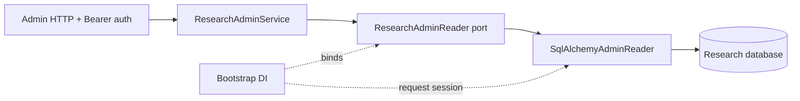

# Admin research API

Admin giúp người vận hành tìm và đọc research job có sẵn qua API được bảo vệ bằng
`ADMIN_TOKEN`. Mỗi GET chỉ đọc database, không gửi queue và không gọi AI hay Tavily.
Không cần chạy paid demo; database trống trả `items: []` là bình thường.

Trạng thái: **IMPLEMENTED — 2026-10-18**. Đã hoàn thành mọi layer và tài liệu kèm theo.
Full suite **488 passed, 0 skipped** với SQLite/PostgreSQL/Redis thật; Ruff và Alembic
check đạt. F001 (COLLECT) và F002 (provider routing) được giữ tương thích. Xem
[bằng chứng và giới hạn](07-testing-troubleshooting.md).

Đọc theo thứ tự:

1. [Domain](01-domain.md)
2. [Application](02-application.md)
3. [Infrastructure](03-infrastructure.md)
4. [Bootstrap và DI](04-bootstrap-di.md)
5. [HTTP, Swagger, Postman](05-api.md)
6. [Hai luồng end to end](06-end-to-end.md)
7. [Kiểm thử và xử lý lỗi](07-testing-troubleshooting.md)

Các mũi tên liền mô tả lời gọi runtime; implementation phụ thuộc vào hợp đồng của
application. Bootstrap biết cả hai phía để nối chúng. Domain research giữ policy
workflow; admin không tạo domain mới hoặc tự quyết định job có được retry hay không.
