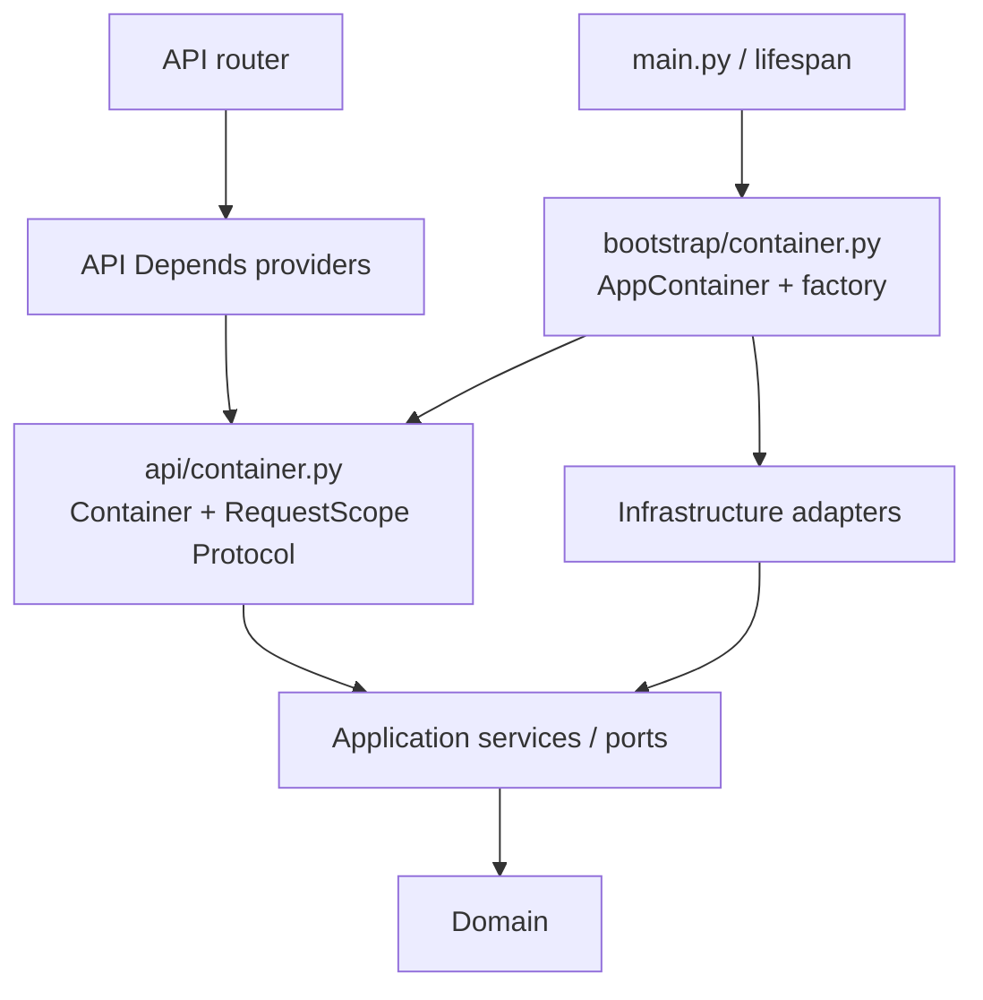

# Hướng dẫn thiết kế DI container riêng cho FastAPI

Ngày đối chiếu code: **18/10/2026**.

**Trạng thái: hướng dẫn thiết kế và lộ trình refactor, chưa triển khai vào runtime.**
Dự án hiện vẫn dùng `configure_dependencies(app)` và `app.dependency_overrides`
để nối API dependency với implementation. Các file và chữ ký mới trong guide là
thiết kế đích; không giả định chúng đã tồn tại. Đọc phần migration và test trước
khi áp dụng. Việc viết guide này không thay đổi API, database hoặc worker.

Mục tiêu là để sau này có thể chuyển sang container mà vẫn giữ kiến trúc DDD,
session riêng cho từng request, transaction ngắn và khả năng test bằng fake.
Container trong guide là một object Python quản lý cách lắp dependency và scope.
Thiết kế này dùng thư viện chuẩn Python cùng FastAPI hiện có, chưa cần thêm
framework DI.

## Mục lục

1. [Thiết kế hiện tại và lý do cân nhắc container](#hien-tai)
2. [Khái niệm và các invariant phải giữ](#khai-niem)
3. [Kiến trúc và cấu trúc file đích](#kien-truc)
4. [Hợp đồng container cho API](#hop-dong)
5. [Container thật và request scope tạo dependency theo nhu cầu](#container-that)
6. [Lifespan và application factory](#lifespan)
7. [Cầu nối từ FastAPI Depends sang container](#fastapi)
8. [Luồng chạy thực tế](#luong-chay)
9. [Test và quyền sở hữu tài nguyên](#test)
10. [Lộ trình migration từ code hiện tại](#migration)
11. [Mở rộng domain, adapter và tài nguyên](#mo-rong)
12. [Transaction, concurrency và background task](#transaction)
13. [Đo hiệu năng và tối ưu khi có bằng chứng](#hieu-nang)
14. [Debug và các lỗi thường gặp](#debug)
15. [Checklist áp dụng và tài liệu tham khảo](#checklist)

<a id="hien-tai"></a>

## 1. Thiết kế hiện tại và lý do cân nhắc container

### 1.1. Những file cần đọc trước

| File hiện có | Vai trò |
|---|---|
| [main.py](../src/company_ai/main.py) | `create_app(settings)`, gọi `configure_dependencies`, gắn router/middleware |
| [bootstrap/dependencies.py](../src/company_ai/bootstrap/dependencies.py) | Binding concrete provider và `get_session` |
| [bootstrap/lifespan.py](../src/company_ai/bootstrap/lifespan.py) | Tạo/đóng Database và Redis của API |
| [api/dependencies.py](../src/company_ai/api/dependencies.py) | Settings, admin auth, readiness contract |
| [api/research/dependencies.py](../src/company_ai/api/research/dependencies.py) | Repository/publisher provider, `JobService`, alias `Jobs` |
| [api/admin/dependencies.py](../src/company_ai/api/admin/dependencies.py) | Admin reader provider, `ResearchAdminService`, alias `Admin` |
| [database/transactions.py](../src/company_ai/infrastructure/database/transactions.py) | Ranh giới transaction của `SessionOperations` |
| [test_architecture.py](../tests/unit/test_architecture.py) | Kiểm tra chiều import giữa các layer |

Đọc thêm [kiến trúc hiện tại](architecture.vi.md) và
[bootstrap/admin DI hiện tại](admin/04-bootstrap-di.md). Các tài liệu đó mô tả
runtime đang có; guide này mô tả một phương án thay thế trong tương lai.

### 1.2. Năm binding hiện có sẽ chuyển đi đâu?

| Dependency API | Binding hiện tại | Đích trong container |
|---|---|---|
| `get_research_repository` | `get_sqlalchemy_research_repository` | `scope.research_repository()` |
| `get_admin_reader` | `get_sqlalchemy_admin_reader` | `scope.admin_reader()` |
| `get_job_publisher` | `get_celery_publisher` | `container.publisher` |
| `get_database_ready` | `get_sqlalchemy_readiness` | Trả callable `container.database_ready` |
| `get_broker_ping` | `get_redis_ping` | Trả callable `container.broker_ping` |

Hiện FastAPI nhìn vào `dependency_overrides` để tìm provider thay thế. Với container,
các provider API có implementation thật: chúng lấy dependency từ container.
`dependency_overrides` vẫn có thể dùng trong test, nhưng production không cần
đăng ký năm binding trên vào dictionary đó.

### 1.3. Khi nào đáng chuyển?

Cân nhắc chuyển khi có nhiều domain/provider, nhiều biến thể wiring theo môi
trường, test fixture khó quản lý tài nguyên, hoặc khó tìm nơi tạo dependency.
Với năm binding hiện tại, giữ mapping tường minh vẫn hợp lý.

Container đem lại một nơi rõ ràng để cấu hình implementation và vòng đời tài
nguyên. Đổi lại, phải duy trì hợp đồng container, cầu nối FastAPI và test scope.
Đây là lựa chọn tổ chức code; chưa có benchmark chứng minh sẽ làm dự án chạy nhanh
hơn. Việc đăng ký `.update()` chỉ chạy khi tạo app, còn quá trình resolve dependency
vẫn có công việc ở mỗi request.

<a id="khai-niem"></a>

## 2. Khái niệm và các invariant phải giữ

### 2.1. Container, factory, scope và port khác nhau thế nào?

| Khái niệm | Câu hỏi nó trả lời | Ví dụ |
|---|---|---|
| Port | Nghiệp vụ cần hành vi gì? | `ResearchJobRepository`, `JobPublisher` |
| Adapter | Ai thực hiện hành vi đó? | `SqlAlchemyResearchRepository`, hàm `publish` |
| Container | Lắp các adapter với cấu hình nào? | `AppContainer` |
| Factory | Tạo container và quản lý tài nguyên bao quanh nó thế nào? | `open_container(settings)` |
| Request scope | Những dependency nào được dùng chung trong một request? | Session, repository, admin reader |
| FastAPI provider | Đưa dependency từ container vào tham số endpoint thế nào? | `get_research_repository(scope)` |

`Protocol` chỉ mô tả hợp đồng cho type checker và người đọc. Nó không tự tạo object,
resolve dependency, cache hoặc đóng tài nguyên. Trong thiết kế này, tất cả công việc
đó được viết tường minh bằng constructor, `Depends` và context manager.

### 2.2. Phạm vi sống đề xuất

| Object | Tạo lúc nào? | Dùng chung ở đâu? | Ai kết thúc lifetime? |
|---|---|---|---|
| `AppContainer` | Vào lifespan | Trong một app/lifespan đang chạy | Lifespan và container factory |
| `Database` gồm engine/session factory | Vào production container factory | Trong event loop/process sở hữu nó | Factory gọi `dispose()` |
| Redis client | Vào production container factory | Trong app sở hữu client | Factory gọi `aclose()` |
| Settings, publisher callable | Khi dựng container | Trong app | Theo lifetime của container; callable không có tài nguyên cần đóng trong ví dụ này |
| Request scope | Dependency của một request cần persistence | Các nhánh dùng cùng `get_request_scope` | Yield dependency của FastAPI |
| `AsyncSession` | Lần đầu scope cần repository/reader | Các thao tác tuần tự trong scope | `AsyncExitStack` của scope |
| Repository/admin reader | Lần đầu scope yêu cầu adapter đó | Trong scope hiện tại | Bỏ tham chiếu sau request; session được đóng bởi scope |
| Application service | Khi FastAPI resolve service provider | Cache dependency mặc định trong request | Theo request |

App container lưu **session factory**, không lưu một session chung cho mọi request.
Một engine cũng không phải một connection duy nhất: engine quản lý cách lấy/trả
connection; session có thể chỉ checkout connection khi bắt đầu làm việc với DB.

### 2.3. Những hành vi cần giữ nguyên khi refactor

1. Import `main` và gọi `create_app()` không tạo engine/Redis client.
2. Mỗi request có scope riêng; request đồng thời không dùng chung `AsyncSession`.
3. Các nhánh persistence trong cùng request dùng một scope/session khi phù hợp.
4. Dựng repository/reader/service không chạy SQL.
5. Session đóng khi thành công, lỗi và khi coroutine bị hủy trong quá trình phục vụ.
6. Dependency không tự commit ở cuối request. `SessionOperations` vẫn sở hữu
   transaction ngắn của từng thao tác.
7. Job đã commit trước khi publish; không giữ transaction qua broker/provider I/O.
8. `/health` không cần DB; `/ready` không resolve research repository/admin reader.
9. Admin auth, mã HTTP và response schema giữ nguyên.
10. API không import bootstrap, infrastructure hoặc SQLAlchemy. Application/domain
    tiếp tục độc lập với FastAPI và container cụ thể.
11. Test dùng database fixture thì fixture sở hữu việc dispose database đó.
12. HTTP container không trở thành global container dùng chung với Celery worker.

Scope chia sẻ session không có nghĩa các thao tác tự động thành một transaction
nguyên tử. Điều này được giải thích kỹ ở [phần transaction](#transaction).

<a id="kien-truc"></a>

## 3. Kiến trúc và cấu trúc file đích

### 3.1. Chiều import



Mũi tên trên thể hiện chiều phụ thuộc trong code. Khi chạy request, API gọi object
container qua hợp đồng; bootstrap đã cung cấp implementation thực tế cho object đó.

Chỉ các FastAPI provider được phép lấy container từ `request.app.state`. Router
tiếp tục nhận `Jobs`/`Admin`; application service nhận port qua constructor.
Không truyền toàn bộ container vào `JobService`, repository hoặc domain rồi để
chúng tự tìm dependency. Cách đó sẽ che giấu những dependency thật của nghiệp vụ.

### 3.2. Cấu trúc file dự kiến

```text
src/company_ai/
  api/
    container.py                  # Mới: hợp đồng HTTP container/scope
    dependencies.py               # Sửa: cầu nối container, scope, readiness
    research/dependencies.py      # Sửa: lấy repository/publisher từ container
    admin/dependencies.py         # Sửa: lấy reader từ scope
  bootstrap/
    container.py                  # Mới: implementation và resource factory
    lifespan.py                   # Sửa: build_lifespan(factory)
    dependencies.py               # Bỏ binding cũ khi hoàn tất migration
  main.py                         # Sửa: nhận container_factory tùy chọn
```

Đặt hợp đồng container ở API vì nó phục vụ composition của HTTP. Các port nghiệp
vụ vẫn ở application. Nếu sau này API/CLI có nhu cầu chung thực sự, có thể tách hợp
đồng composition sang module trung lập; không đưa FastAPI hoặc SQLAlchemy vào
application chỉ để chia sẻ container.

<a id="hop-dong"></a>

## 4. Hợp đồng container cho API

**File mới đề xuất:** `src/company_ai/api/container.py`.

Đây là một module hoàn chỉnh trong thiết kế đích:

```python
from collections.abc import Callable
from contextlib import AbstractAsyncContextManager
from typing import Protocol

from company_ai.application.research.admin_ports import ResearchAdminReader
from company_ai.application.research.ports import JobPublisher, ResearchJobRepository
from company_ai.settings import Settings


class RequestScope(Protocol):
    async def research_repository(self) -> ResearchJobRepository: ...

    async def admin_reader(self) -> ResearchAdminReader: ...


class Container(Protocol):
    @property
    def publisher(self) -> JobPublisher: ...

    def request_scope(self) -> AbstractAsyncContextManager[RequestScope]: ...

    async def database_ready(self) -> object: ...

    async def broker_ping(self) -> object: ...


ContainerFactory = Callable[[Settings], AbstractAsyncContextManager[Container]]
```

Các chi tiết dễ nhầm:

- `request_scope` là `def` trả về async context manager, nên caller dùng
  `async with container.request_scope()`. Không khai báo nó là coroutine trả
  context manager rồi buộc caller phải `await` trước khi `async with`.
- Các method của `RequestScope` là `async def` vì có thể cần enter session context.
- Readiness method được gọi bằng `await`. FastAPI provider ở phần sau sẽ trả
  **bound method**, chưa gọi kiểm tra ngay khi resolve dependency.
- API thấy `ResearchJobRepository`/`ResearchAdminReader`, không thấy `AsyncSession`.
- Không dùng `@runtime_checkable` hoặc `isinstance(container, Container)` để hứa
  kiểm tra sâu kiểu tham số/return value; validation hành vi cần test riêng.

<a id="container-that"></a>

## 5. Container thật và request scope tạo dependency theo nhu cầu

### 5.1. Vì sao không tạo sẵn mọi service trong một dataclass?

Ví dụ đơn giản `RequestServices(jobs=..., admin=...)` giúp giải thích ý tưởng,
nhưng nếu dựng toàn bộ graph ngay khi request vào thì test override repository vẫn
có thể mở session không cần thiết, và một endpoint chỉ cần publisher cũng kéo theo
persistence. Khi domain tăng, chi phí khởi tạo và coupling càng khó nhìn.

Guide chọn **scope tạo adapter khi được yêu cầu**. Scope chưa được dùng tới DB
thì chưa tạo session; từng adapter được cache trong scope. Application service
vẫn được tạo ở API provider như hiện tại để giữ điểm override nhỏ, rõ ràng.

### 5.2. Implementation đầy đủ

**File mới đề xuất:** `src/company_ai/bootstrap/container.py`.

```python
from collections.abc import AsyncIterator
from contextlib import AsyncExitStack, asynccontextmanager
from dataclasses import dataclass
from typing import Protocol

from redis.asyncio import Redis
from sqlalchemy.ext.asyncio import AsyncSession

from company_ai.api.container import Container, RequestScope
from company_ai.application.research.admin_ports import ResearchAdminReader
from company_ai.application.research.ports import JobPublisher, ResearchJobRepository
from company_ai.infrastructure.database.session import Database
from company_ai.infrastructure.database.transactions import SessionOperations
from company_ai.infrastructure.messaging import publish
from company_ai.infrastructure.research.persistence.admin_reader import SqlAlchemyAdminReader
from company_ai.infrastructure.research.persistence.readiness import research_database_ready
from company_ai.infrastructure.research.persistence.repositories import SqlAlchemyResearchRepository
from company_ai.settings import Settings


class BrokerProbe(Protocol):
    async def ping(self) -> object: ...


class SqlAlchemyRequestScope:
    def __init__(
        self,
        database: Database,
        settings: Settings,
        resources: AsyncExitStack,
    ) -> None:
        self._database = database
        self._settings = settings
        self._resources = resources
        self._session: AsyncSession | None = None
        self._repository: ResearchJobRepository | None = None
        self._reader: ResearchAdminReader | None = None
        self._active = True

    def _ensure_active(self) -> None:
        if not self._active:
            raise RuntimeError("Request scope is closed")

    def invalidate(self) -> None:
        # AsyncExitStack closes resources; this flag rejects later scope access.
        self._active = False

    async def _get_session(self) -> AsyncSession:
        self._ensure_active()
        if self._session is None:
            self._session = await self._resources.enter_async_context(
                self._database.session()
            )
        return self._session

    async def research_repository(self) -> ResearchJobRepository:
        self._ensure_active()
        if self._repository is None:
            session = await self._get_session()
            self._repository = SqlAlchemyResearchRepository(
                SessionOperations(session), self._settings
            )
        return self._repository

    async def admin_reader(self) -> ResearchAdminReader:
        self._ensure_active()
        if self._reader is None:
            self._reader = SqlAlchemyAdminReader(await self._get_session())
        return self._reader


@dataclass(frozen=True)
class AppContainer:
    database: Database
    settings: Settings
    publisher: JobPublisher
    broker: BrokerProbe

    @asynccontextmanager
    async def request_scope(self) -> AsyncIterator[RequestScope]:
        async with AsyncExitStack() as resources:
            scope = SqlAlchemyRequestScope(self.database, self.settings, resources)
            try:
                yield scope
            finally:
                scope.invalidate()

    async def database_ready(self) -> object:
        await research_database_ready(self.database)
        return None

    async def broker_ping(self) -> object:
        return await self.broker.ping()


@asynccontextmanager
async def open_container(settings: Settings) -> AsyncIterator[Container]:
    async with AsyncExitStack() as resources:
        database = Database(settings.database_dsn, settings=settings)
        resources.push_async_callback(database.dispose)

        broker = Redis.from_url(
            settings.redis_url,
            socket_connect_timeout=2,
            socket_timeout=2,
        )
        resources.push_async_callback(broker.aclose)

        yield AppContainer(
            database=database,
            settings=settings,
            publisher=publish,
            broker=broker,
        )
```

### 5.3. Ai sở hữu tài nguyên?

`open_container` tạo Database/Redis nên đăng ký cleanup ngay sau khi tạo thành
công. Nếu tạo Redis hoặc dựng container gặp lỗi, database đã đăng ký vẫn được
dispose. Khi kết thúc, `AsyncExitStack` cleanup theo thứ tự ngược: Redis rồi database.

`AppContainer` nhận tài nguyên đã được tạo. Nó không tự dispose database trong
`request_scope`, vì các request khác vẫn dùng session factory của database đó.
Scope chỉ sở hữu session nó enter vào stack của chính mình.

`BrokerProbe` là hợp đồng nội bộ nhỏ cho thao tác ping; production dùng Redis,
test có thể dùng `BrokerStub` mà không phải giả lập toàn bộ Redis client.

Điểm phân chia này cho phép test truyền database có sẵn mà không để container
tự đóng tài nguyên của fixture. Không dùng flag `owns_database=True/False` ở nhiều
chỗ nếu có thể thể hiện ownership trực tiếp bằng factory/context manager.

### 5.4. Ba lớp tái sử dụng khác nhau

1. FastAPI cache `get_request_scope` trong request để các provider nhận cùng scope.
2. Scope cache session, repository và reader để các lần truy cập tuần tự tái sử
   dụng cùng object trong scope đó.
3. Engine/pool tái sử dụng connection theo cơ chế của SQLAlchemy, độc lập với hai
   lớp cache trên.

`invalidate()` giúp phát hiện việc gọi scope sau teardown. Nó không chặn mọi cách
dùng sai: nếu caller đã giữ repository riêng ra ngoài scope thì vẫn có thể gọi
object đó. Quy tắc thiết kế vẫn là không giữ request dependency sau request và
không truyền nó vào background task.

Scope này phục vụ thao tác tuần tự. Hai coroutine cùng gọi `_get_session()` hoặc
dùng adapter đồng thời không được bảo vệ bởi lock; chúng cần scope/session riêng.

<a id="lifespan"></a>

## 6. Lifespan và application factory

### 6.1. Lifespan nhận factory thay vì tự dò override

**Thiết kế thay thế cho:** `src/company_ai/bootstrap/lifespan.py`.

```python
from contextlib import asynccontextmanager

from fastapi import FastAPI

from company_ai.api.container import ContainerFactory
from company_ai.bootstrap.container import open_container


def build_lifespan(container_factory: ContainerFactory = open_container):
    @asynccontextmanager
    async def lifespan(app: FastAPI):
        async with container_factory(app.state.settings) as container:
            app.state.container = container
            try:
                yield
            finally:
                del app.state.container

    return lifespan
```

Việc gọi `build_lifespan()` chỉ tạo hàm lifecycle, chưa gọi `open_container`.
Database/Redis được tạo khi lifespan thực sự bắt đầu. `app.state.container` được
xóa trước khi factory đóng tài nguyên, kể cả khi phần thân lifespan báo lỗi.
Test đi qua lifespan nhiều lần phải nhận tài nguyên mới trong mỗi lần do production
factory tạo; không tái dùng engine đã đóng từ lần trước.

### 6.2. Chỉnh `create_app`

Đây là phần thay đổi cần ghép vào `main.py`, không phải toàn bộ file thay thế:

```diff
+from company_ai.api.container import ContainerFactory
 from company_ai.api.router import router
 from company_ai.application.research.jobs import JobNotFound
-from company_ai.bootstrap.dependencies import configure_dependencies
-from company_ai.bootstrap.lifespan import lifespan
+from company_ai.bootstrap.container import open_container
+from company_ai.bootstrap.lifespan import build_lifespan

-def create_app(settings: Settings | None = None) -> FastAPI:
+def create_app(
+    settings: Settings | None = None,
+    *,
+    container_factory: ContainerFactory = open_container,
+) -> FastAPI:
     settings = settings or get_settings()
     configure_logging(settings.log_level)
-    app = FastAPI(title="AI Company Research", version="0.2.0", lifespan=lifespan)
+    app = FastAPI(
+        title="AI Company Research",
+        version="0.2.0",
+        lifespan=build_lifespan(container_factory),
+    )
     app.state.settings = settings
-    configure_dependencies(app)
```

Giữ middleware giới hạn payload, tracing, router và exception handler hiện tại.
`app = create_app()` cuối module vẫn chưa mở engine vì chưa enter lifespan.
Tham số `container_factory` là keyword-only để lời gọi test thể hiện rõ ý định.

Đây là chữ ký mới đề xuất; `create_app` trong code hiện tại chưa nhận tham số này.
Không chỉ sửa lời gọi trong test rồi kỳ vọng runtime cũ hiểu được nó.

<a id="fastapi"></a>

## 7. Cầu nối từ FastAPI Depends sang container

### 7.1. Provider chung, settings, auth và readiness

**Thiết kế thay thế cho:** `src/company_ai/api/dependencies.py`.
Ví dụ này giữ nguyên cơ chế auth hiện có, bổ sung provider container/scope và
thay hai readiness placeholder bằng implementation thật.

```python
import secrets
from collections.abc import AsyncIterator, Awaitable, Callable
from typing import Annotated, cast

from fastapi import Depends, HTTPException, Request, Security
from fastapi.security import HTTPAuthorizationCredentials, HTTPBearer

from company_ai.api.container import Container, RequestScope
from company_ai.settings import Settings

ReadinessCheck = Callable[[], Awaitable[object]]


async def get_settings(request: Request) -> Settings:
    return request.app.state.settings


AppSettings = Annotated[Settings, Depends(get_settings)]
admin_bearer = HTTPBearer(
    auto_error=False,
    scheme_name="AdminBearer",
    description="Shared ADMIN_TOKEN for internal administrative access.",
)


async def require_admin(
    settings: AppSettings,
    request: Request,
    _credentials: Annotated[HTTPAuthorizationCredentials | None, Security(admin_bearer)],
) -> None:
    token = settings.admin_token.get_secret_value()
    authorization = request.headers.get("Authorization", "")
    if not token or not secrets.compare_digest(
        authorization.encode("utf-8"), f"Bearer {token}".encode("utf-8")
    ):
        raise HTTPException(401, "ADMIN_AUTH_REQUIRED", headers={"WWW-Authenticate": "Bearer"})


async def get_container(request: Request) -> Container:
    return cast(Container, request.app.state.container)


ContainerDep = Annotated[Container, Depends(get_container)]


async def get_request_scope(container: ContainerDep) -> AsyncIterator[RequestScope]:
    async with container.request_scope() as scope:
        yield scope


Scope = Annotated[RequestScope, Depends(get_request_scope)]


async def get_database_ready(container: ContainerDep) -> ReadinessCheck:
    return container.database_ready


async def get_broker_ping(container: ContainerDep) -> ReadinessCheck:
    return container.broker_ping
```

`cast` không kiểm tra object lúc chạy; nó mô tả kiểu object đã được factory cung
cấp. Startup wiring và test có trách nhiệm bảo đảm factory đúng hợp đồng.
Nếu lifespan chưa chạy, truy cập `app.state.container` sẽ báo lỗi cấu hình.
Không âm thầm tạo container mới ngay trong `get_container`, vì như vậy engine có
thể bị tạo theo request và không có owner cleanup rõ ràng.

Readiness provider trả method, không thực thi probe ở đây. Router `/ready` hiện có
vẫn `await database_ready()` rồi `await broker_ping()` trong `try/except`, nên lỗi
probe được chuyển thành `503 DEPENDENCY_UNAVAILABLE` như trước. Nếu probe bị chạy
sớm trong provider, exception sẽ xảy ra ngoài `try` của router và có thể đổi hành vi.

### 7.2. Research providers

**Thiết kế thay thế cho:** `src/company_ai/api/research/dependencies.py`.

```python
from typing import Annotated

from fastapi import Depends

from company_ai.api.dependencies import ContainerDep, Scope
from company_ai.application.research.jobs import JobService
from company_ai.application.research.ports import JobPublisher, ResearchJobRepository


async def get_research_repository(scope: Scope) -> ResearchJobRepository:
    return await scope.research_repository()


async def get_job_publisher(container: ContainerDep) -> JobPublisher:
    return container.publisher


async def get_job_service(
    repo: Annotated[ResearchJobRepository, Depends(get_research_repository)],
    publisher: Annotated[JobPublisher, Depends(get_job_publisher)],
) -> JobService:
    return JobService(repo, publisher)


Jobs = Annotated[JobService, Depends(get_job_service)]
```

Giữ `get_job_service` phụ thuộc vào hai provider nhỏ giúp test thay repository hoặc
publisher độc lập. Nếu thay thẳng bằng `container.jobs()` rồi xóa hai provider,
các test override port hiện tại sẽ mất điểm can thiệp. Đó là thay đổi hành vi test,
không phải chỉ đổi cách viết.

### 7.3. Admin providers

**Thiết kế thay thế cho:** `src/company_ai/api/admin/dependencies.py`.

```python
from typing import Annotated

from fastapi import Depends

from company_ai.api.dependencies import Scope
from company_ai.application.research.admin_ports import ResearchAdminReader
from company_ai.application.research.admin_service import ResearchAdminService


async def get_admin_reader(scope: Scope) -> ResearchAdminReader:
    return await scope.admin_reader()


async def get_admin_service(
    reader: Annotated[ResearchAdminReader, Depends(get_admin_reader)],
) -> ResearchAdminService:
    return ResearchAdminService(reader)


Admin = Annotated[ResearchAdminService, Depends(get_admin_service)]
```

Router research/admin/health tiếp tục dùng alias/provider cũ. API không import
`AppContainer`, `SqlAlchemyRequestScope` hay SQLAlchemy.

<a id="luong-chay"></a>

## 8. Luồng chạy thực tế

### 8.1. GET research job

```mermaid
sequenceDiagram
    participant API as Router / Jobs
    participant DI as FastAPI providers
    participant C as AppContainer
    participant S as RequestScope
    participant DB as Database/session
    API->>DI: cần get_job_service
    DI->>C: request_scope()
    C-->>DI: scope của request hiện tại
    DI->>S: research_repository()
    S->>DB: enter session khi cần lần đầu
    S-->>DI: SqlAlchemyResearchRepository
    DI->>C: lấy publisher callable
    DI-->>API: JobService(repo, publisher)
    API->>DB: qua service/repository: đọc job
    DB-->>API: domain snapshot
    Note over DI,DB: FastAPI kết thúc yield dependency; scope đóng session
```

Thứ tự chi tiết giữa các provider do FastAPI resolve; không dựa vào thứ tự khai
báo tham số để điều khiển nghiệp vụ. Điểm cần bảo đảm là dependency đã sẵn sàng
trước khi handler sử dụng và teardown diễn ra theo lifetime đã chọn.

### 8.2. Hai nhánh cần persistence trong cùng request

Nếu cả `get_research_repository` và `get_admin_reader` phụ thuộc cùng
`get_request_scope`, FastAPI mặc định tái sử dụng kết quả dependency đó trong request.
Hai adapter gọi cùng `_get_session()` nên nhận cùng session. Request tiếp theo
nhận scope/session mới. Không đặt `use_cache=False` hoặc tự mở thêm scope ở từng
getter nếu đang cần hành vi chia sẻ này.

### 8.3. Health, readiness và fake repository

| Trường hợp | Có request persistence scope? | Có tạo session bởi scope? |
|---|---|---|
| `/health` | Không | Không |
| `/ready` | Không | Không; DB probe tự dùng tài nguyên riêng bên trong adapter readiness |
| GET research job thật | Có | Có khi lấy repository |
| GET admin thật | Có | Có khi lấy reader |
| Test override repository, provider publisher thật | Không cần scope của repository bị thay | Không |
| Test scope được enter nhưng không lấy adapter | Có | Không |

Production container factory vẫn tạo các client/engine của app khi startup.
Override repository không tự bỏ bước startup đó. Muốn test hoàn toàn không dựng
Database/Redis, cần inject **fake container factory** như phần tiếp theo.

<a id="test"></a>

## 9. Test và quyền sở hữu tài nguyên

### 9.1. Chọn đúng lớp cần thay

| Mục tiêu test | Cách tạo app | Điểm thay |
|---|---|---|
| Unit test nghiệp vụ | Không cần FastAPI/container | Truyền fake port vào constructor service |
| HTTP contract không cần DB | Fake container factory | Override repository hoặc reader |
| HTTP với SQLAlchemy thật | Factory mượn DB fixture | Giữ repository/reader thật; fake publisher/broker |
| Kiểm tra startup/shutdown | Production factory với resource spy | Kiểm tra tạo muộn, dispose và state cleanup |
| Kiểm tra readiness | Factory có probe spy hoặc override readiness provider | Xác nhận DB/broker được await và lỗi trả 503 |

Giữ nguyên việc test service bằng constructor. Không bắt unit test nghiệp vụ
phải dựng container chỉ vì HTTP đã dùng container.

### 9.2. Fixture mượn database thật, không tự dispose

Đoạn sau là thiết kế thay thế cho fixture `app_factory` trong
[tests/conftest.py](../tests/conftest.py). Giữ nguyên các fixture `settings`, `repo`,
`client_factory` và các import khác còn dùng. Các import dưới đây cần được ghép
vào đầu file.

```python
from contextlib import asynccontextmanager

import pytest

from company_ai.bootstrap.container import AppContainer
from company_ai.main import create_app


class BrokerStub:
    async def ping(self) -> object:
        return True


@pytest.fixture
def app_factory(repo, settings):
    def create(enqueue=None):
        async def discard(_job_id):
            pass

        @asynccontextmanager
        async def borrowed_container(current_settings):
            yield AppContainer(
                database=repo.db,
                settings=current_settings,
                publisher=enqueue if enqueue is not None else discard,
                broker=BrokerStub(),
            )

        return create_app(settings, container_factory=borrowed_container)

    return create
```

Fixture `repo` hiện tại tạo schema/engine và dispose trong `finally`. Factory ở
trên chỉ mượn `repo.db`; không gọi `open_container` và không đăng ký dispose cho
database mượn đó. Vì thế không có engine thứ hai và không đóng nhầm engine fixture.
`BrokerStub` cũng không tạo socket.

Không giữ cách cũ `app.dependency_overrides[get_database] = database` rồi hy vọng
factory mới tự nhận ra DB fixture. Thiết kế đích truyền ownership qua
`container_factory`; nó không còn dò dictionary override để quyết định tạo engine.

### 9.3. Test HTTP dùng fake repository hoàn toàn không có database

Ví dụ module test **sau migration**, có thể đặt ở
`tests/integration/test_container_http.py`:

```python
from contextlib import AbstractAsyncContextManager, asynccontextmanager

import httpx

from company_ai.api.container import RequestScope
from company_ai.api.research.dependencies import get_research_repository
from company_ai.main import create_app


async def discard(_job_id: str) -> None:
    pass


class NoDatabaseContainer:
    publisher = staticmethod(discard)

    def request_scope(self) -> AbstractAsyncContextManager[RequestScope]:
        raise AssertionError("Fake repository must bypass persistence scope")

    async def database_ready(self) -> object:
        return True

    async def broker_ping(self) -> object:
        return True


class MissingJobs:
    async def get_job(self, job_id):
        return None, []


async def test_override_repository_without_database(settings):
    @asynccontextmanager
    async def fake_container_factory(_settings):
        yield NoDatabaseContainer()

    async def fake_repository():
        return MissingJobs()

    app = create_app(settings, container_factory=fake_container_factory)
    app.dependency_overrides[get_research_repository] = fake_repository

    async with app.router.lifespan_context(app):
        async with httpx.AsyncClient(
            transport=httpx.ASGITransport(app=app), base_url="http://test"
        ) as client:
            response = await client.get("/api/v1/research/jobs/missing")

    assert response.status_code == 404
    assert not hasattr(app.state, "container")
```

`MissingJobs` chỉ fake hành vi được endpoint này gọi; nó không phải implementation
đầy đủ của `ResearchJobRepository` cho mọi use case. Nếu cần kiểm tra bằng type
checker cho cả port, viết fake đầy đủ thay vì gắn ép kiểu để bỏ qua method thiếu.

Test cố ý làm `request_scope()` báo lỗi nếu bị gọi. Request vẫn phải đi đến kết
quả 404 theo nghiệp vụ, chứng minh override đã bỏ qua nhánh persistence. Chỉ đổi
factory sang `NoDatabaseContainer` mà không override repository sẽ làm request
báo lỗi; fake factory và fake port có trách nhiệm khác nhau.

`httpx.ASGITransport` không tự chạy lifespan trong cách dùng này, nên test enter
`app.router.lifespan_context(app)` tường minh, giống tinh thần `client_factory`
hiện có. Một HTTP test không enter lifespan không kiểm tra được wiring startup.

### 9.4. Test scope tạo muộn, tái sử dụng và cleanup

Ví dụ module **sau migration**, dùng fixture `repo` hiện có:

```python
import asyncio
from contextlib import asynccontextmanager

import pytest

from company_ai.bootstrap.container import AppContainer


class BrokerStub:
    async def ping(self) -> object:
        return True


async def discard(_job_id: str) -> None:
    pass


@pytest.mark.parametrize("error_type", [RuntimeError, asyncio.CancelledError])
async def test_scope_lifetime(repo, settings, monkeypatch, error_type):
    opened, closed = [], []
    original_factory = repo.db.session

    @asynccontextmanager
    async def tracked_session():
        session = original_factory()
        try:
            async with session:
                opened.append(session)
                yield session
        finally:
            assert not session.in_transaction()
            closed.append(session)

    monkeypatch.setattr(repo.db, "session", tracked_session)
    container = AppContainer(repo.db, settings, discard, BrokerStub())

    async with container.request_scope():
        assert opened == []

    async with container.request_scope() as first_scope:
        first_repository = await first_scope.research_repository()
        assert await first_scope.research_repository() is first_repository
        await first_scope.admin_reader()
        assert len(opened) == 1

    assert closed == opened
    with pytest.raises(RuntimeError, match="Request scope is closed"):
        await first_scope.research_repository()

    with pytest.raises(error_type):
        async with container.request_scope() as second_scope:
            assert await second_scope.research_repository() is not first_repository
            raise error_type()

    assert len(opened) == 2
    assert opened[0] is not opened[1]
    assert closed == opened
```

Đây là test ownership và lifetime, chưa thay thế test SQL/transaction thật. Nó
dùng `CancelledError` để kiểm tra nhánh thoát do hủy; cần bổ sung test task đang
thực thi bị `cancel()` nếu thay đổi cơ chế shield/cleanup hoặc phiên bản framework.
Không bắt và nuốt `CancelledError` để biến request bị hủy thành thành công.

### 9.5. Những test hiện tại phải được cập nhật, không được bỏ ý nghĩa

| Test hiện có | Thay đổi cần thiết sau migration |
|---|---|
| [test_architecture.py](../tests/unit/test_architecture.py) | Giữ các chiều import cấm; module API mới cũng phải được quét |
| [test_app_lifecycle.py](../tests/unit/test_app_lifecycle.py) | Spy resource ở factory mới; kiểm tra `app.state.container`, tạo muộn, lỗi startup, cleanup, restart lifespan |
| [test_dependency_injection.py](../tests/integration/test_dependency_injection.py) | Chuyển test `get_session` sang scope/resource tracking; giữ session isolation, rollback và commit trước publish |
| [test_admin_dependencies.py](../tests/integration/test_admin_dependencies.py) | Thay assertion exact override mapping bằng construction qua scope; giữ không chạy SQL và khả năng fake reader |
| [test_readiness.py](../tests/integration/test_readiness.py) | Giữ probe độc lập, thứ tự DB rồi broker, 503 an toàn, không resolve repository |
| [test_admin_api.py](../tests/integration/test_admin_api.py) | Giữ auth, filter/paging/schema và response behavior |
| [test_api.py](../tests/integration/test_api.py) | Giữ HTTP research và idempotency |
| [test_async_invariants.py](../tests/integration/test_async_invariants.py) | Giữ async/transaction invariant liên quan |

Bổ sung test hai nhánh `Depends(get_request_scope)` nhận cùng object trong cùng
request, còn request tiếp theo nhận object khác. Test này kiểm tra cầu nối FastAPI;
test gọi `container.request_scope()` trực tiếp chưa đủ chứng minh cơ chế cache HTTP.

Bổ sung test tạo hai app với hai factory khác nhau: fake/override của app A không
ảnh hưởng app B. Với production factory, test lỗi khởi tạo resource thứ hai phải
chứng minh resource thứ nhất vẫn được cleanup; chỉ test lỗi trong handler chưa
bao phủ nhánh startup này.

<a id="migration"></a>

## 10. Lộ trình migration từ code hiện tại

### 10.1. Chuẩn bị trước khi đổi wiring

1. Xác định mục tiêu: dễ quản lý provider, thay factory theo môi trường, hay đo
   hiệu năng. Không refactor chỉ vì tên `dependency_overrides` trông giống test.
2. Chạy bộ test baseline liên quan với cấu hình local. Ghi rõ backend nào được chạy
   và trường hợp PostgreSQL nào bị skip.
3. Tìm toàn bộ consumer của provider cũ, gồm test, fixture và tài liệu:

```powershell
rg -n 'configure_dependencies|dependency_overrides|get_database|get_session|get_sqlalchemy_' src tests docs README.md
```

4. Thêm contract/container mới và test scope khi runtime hiện tại vẫn đang dùng
   wiring cũ. Không xóa provider cũ ở bước này.

### 10.2. Chuyển wiring trong một thay đổi nhất quán

1. Đổi `api/dependencies.py`: thêm container/scope getter và thay readiness provider.
2. Đổi research/admin provider để gọi scope; giữ tên `get_research_repository`,
   `get_job_publisher`, `get_admin_reader`, `Jobs` và `Admin`.
3. Đổi lifespan/main sang factory; đồng thời chuyển fixture sang borrowed/fake factory.
4. Bỏ đăng ký năm production override cũ khi tất cả provider tương ứng đã có thân
   hàm mới. Override cũ còn tồn tại sẽ tiếp tục chặn provider mới và che mất lỗi wiring.
5. Xóa các hàm binding/session cũ chỉ khi `rg` xác nhận không còn consumer cần chúng.
   `bootstrap.dependencies.get_session` từng được test như provider dùng chung;
   cần chuyển điểm mở rộng sang scope trước khi bỏ nó.
6. Cập nhật test theo hành vi ở phần 9; giữ nguyên các invariant persistence.

Không để runtime dùng nửa lifespan mới và nửa provider cũ. Provider cũ đọc
`app.state.database`/`broker`, còn thiết kế đích lưu `app.state.container`. Nếu cần
giai đoạn tương thích, phải thiết kế adapter tường minh và test nó; không dựa vào
việc tình cờ có state còn sót từ test trước.

### 10.3. Bộ kiểm tra trước khi chấp nhận migration

Các lệnh dưới đây dành cho lúc **đã refactor runtime**, không phải yêu cầu chạy
test container mới trên code cũ chỉ vì guide đã được thêm:

```powershell
.\.venv\Scripts\python.exe -m ruff check src tests

$diTestPaths = @(
    'tests/unit/test_architecture.py'
    'tests/unit/test_app_lifecycle.py'
    'tests/integration/test_dependency_injection.py'
    'tests/integration/test_admin_dependencies.py'
    'tests/integration/test_readiness.py'
    'tests/integration/test_admin_api.py'
    'tests/integration/test_api.py'
    'tests/integration/test_async_invariants.py'
)
& .\.venv\Scripts\python.exe -m pytest @diTestPaths -q
```

Thêm các file test container mới vào danh sách sau khi chúng được tạo. Fixture
hiện tại chỉ chạy nhánh PostgreSQL thật khi có `TEST_POSTGRES_URL`. Nhánh bị skip
không phải bằng chứng PostgreSQL đã đạt. Dùng database test/schema cô lập theo
fixture hiện tại; không đổi fixture để xóa dữ liệu dùng chung.

Khi nhóm test liên quan đạt, chạy bộ regression cần thiết theo phạm vi thay đổi.
Nếu chỉ sửa wiring, không thêm schema migration. Nếu kết quả HTTP thay đổi, kiểm
tra lại refactor trước khi sửa expected response để làm test xanh.

### 10.4. Tài liệu và rollback

Khi container thật sự được triển khai, cập nhật README,
[architecture.vi.md](architecture.vi.md), [admin/04-bootstrap-di.md](admin/04-bootstrap-di.md)
và các walkthrough có nhắc mapping/state cũ. Đổi trạng thái guide này sang đã triển
khai và ghi lại những ví dụ còn khác implementation.

Rollback wiring bằng một thay đổi nhất quán gồm provider, lifespan, main và fixture.
Refactor này không đổi schema nên rollback không cần đảo dữ liệu. Không gọi lại
`configure_dependencies` trên một app đã chuyển nửa chừng rồi xem đó là rollback.

<a id="mo-rong"></a>

## 11. Mở rộng domain, adapter và tài nguyên

### 11.1. Thêm bounded context mới, ví dụ campaign

1. Định nghĩa entity/quy tắc ở domain và port/use case ở application của campaign.
2. Viết SQLAlchemy adapter ở infrastructure/campaign.
3. Thêm accessor rõ kiểu vào `RequestScope`, ví dụ `campaign_repository()`.
4. Implement accessor ở concrete scope, dùng `_get_session()` nếu cần cùng DB và
   cùng lifetime; cache adapter riêng trong scope.
5. Thêm FastAPI provider và alias `Campaigns`, để router chỉ nhận service.
6. Test domain mới độc lập; thêm test chia sẻ session chỉ khi đó là yêu cầu thật.

Ví dụ method dưới đây là **fragment mở rộng**, không phải module hoàn chỉnh.
Các kiểu campaign và field `_campaign_repository` phải được khai báo trước:

```python
async def campaign_repository(self) -> CampaignRepository:
    self._ensure_active()
    if self._campaign_repository is None:
        session = await self._get_session()
        self._campaign_repository = SqlAlchemyCampaignRepository(session)
    return self._campaign_repository
```

Khi container có nhiều context, tách `ResearchScope`, `CampaignScope` hoặc module
factory theo context để tránh một file ngày càng lớn. Các scope con có thể mượn
session accessor/stack của scope cha khi thật sự cần chia sẻ; không tự mở session
riêng ở mỗi module rồi mặc định coi chúng là một transaction.

Admin hiện là nhóm use case quản trị research. Có router admin không tự động có
nghĩa cần một bounded context admin độc lập.

### 11.2. Thay publisher hoặc repository implementation

Với publisher khác, factory cung cấp một object/hàm đáp ứng `JobPublisher`.
`JobService` vẫn nhận callable qua constructor; API không chọn implementation bằng
`if environment == ...` trong mỗi request.

Với backend persistence khác, viết request scope đáp ứng cùng hợp đồng và container
trả scope đó. Không ép backend mới có thuộc tính `.db` giống SQLAlchemy để service
hoạt động; application chỉ dùng port đã khai báo. Kiểm tra cả idempotency, retry,
commit trước publish và snapshot mapping, không chỉ chữ ký method.

### 11.3. Thêm HTTP client, cache hoặc tài nguyên async khác

Trước khi thêm field vào container, xác định owner, loop/process sở hữu, concurrency
của client, thời điểm tạo và phương thức đóng. Resource dùng chung theo app có thể
được enter/đăng ký cleanup trong factory. Resource dùng theo request thuộc stack
của request scope. Resource chỉ có ở workflow worker thuộc factory/lifecycle worker.

Giữ tạo theo nhu cầu nếu adapter không cần ở mọi chế độ. Ví dụ manual workflow
không nên bắt buộc khởi tạo collector/client Tavily chỉ vì container có accessor
cho collection. Client có state mutable, credentials theo tenant hoặc ngữ cảnh
transaction cần một quyết định scope riêng.

### 11.4. Multi-tenant hoặc tài nguyên theo người dùng

Container app giữ cấu hình/factory dùng chung; tenant/user context phải đến từ
request đã xác thực và được đưa vào scope/port tường minh. Không gán
`container.current_tenant = ...` ở từng request, vì các request đồng thời sẽ ghi
đè state dùng chung. Nếu tenant chọn database/schema, test cả isolation và giới
hạn số engine/pool có thể tồn tại.

### 11.5. Khi nào cân nhắc framework DI?

Khi container thủ công đã có nhiều scope lồng nhau, nhiều provider dùng lại giữa
HTTP/CLI/worker, hoặc nhiều dependency graph khác nhau cần validate tự động, có
thể đánh giá một framework DI qua thử nghiệm nhỏ.

Tiêu chí đánh giá: async resource cleanup, scope theo request/task, typed contract,
override có isolation, khả năng debug graph, mức phụ thuộc vào framework và chi
phí migration. Test lại toàn bộ invariant trước khi chọn. Không đồng thời đổi
container, transaction model và persistence backend trong một refactor.

<a id="transaction"></a>

## 12. Transaction, concurrency và background task

### 12.1. Request scope không phải Unit of Work

`SessionOperations` hiện yêu cầu session idle trước mỗi operation. Write operation
có transaction riêng và commit trước khi trả; read operation kết thúc autobegin
bằng rollback trước khi trả snapshot/DTO. Scope bên ngoài chỉ quản lý lifetime.

Vì vậy không bọc toàn bộ `request_scope()` bằng `session.begin()` và không thêm
`await session.commit()` sau `yield`. Làm vậy thay đổi thời điểm commit, có thể
publish trước commit, hoặc gây lỗi `Research operation requires an idle session`.

Nếu use case mới cần cập nhật hai repository trong **cùng một transaction nguyên
tử**, định nghĩa Unit of Work và các adapter tham gia transaction đó. Những method
research đang tự commit theo operation không tự nhiên trở thành một phần của UoW
chỉ vì dùng cùng session.

Reader admin hiện tại cũng dùng `SessionOperations` để kết thúc read transaction.
Nếu adapter mới dùng session trực tiếp rồi trả về khi autobegin còn mở, operation
research tiếp theo trên cùng session sẽ bị chặn. Khi mở rộng, test trạng thái
transaction tại ranh giới operation; không dùng rollback tùy tiện để che lỗi
ownership hoặc làm mất phần ghi của use case.

### 12.2. Session chung trong request chỉ dành cho thao tác tuần tự

`AsyncSession` có state transaction; không dùng một session đồng thời trong nhiều
task. Nếu thật sự cần `asyncio.gather` cho hai thao tác DB độc lập, mỗi task phải
có scope/session riêng và không kỳ vọng chúng chung transaction. Đây cũng là
[quy tắc concurrency của SQLAlchemy](https://docs.sqlalchemy.org/en/20/orm/extensions/asyncio.html#using-asyncsession-with-concurrent-tasks).

Không dùng lock để âm thầm biến một session chung toàn app thành request session.
Thay vào đó, thể hiện đúng ownership và mức song song ở nơi tạo scope.

### 12.3. Background task và streaming response

Background task nhận ID hoặc dữ liệu độc lập rồi mở scope của chính nó khi chạy.
Không nhận `JobService`, repository, scope hay session đã tạo cho request. Nếu task
có thể sống lâu hơn app/event loop, tài nguyên của task phải có owner phù hợp;
không dùng HTTP app container sau shutdown.

Streaming response có thể giữ yield dependency lâu hơn thời gian handler trả về.
Nếu stream chỉ cần DTO đã đọc xong, thiết kế để đọc và đóng persistence scope trước
khi stream kéo dài. Nếu stream thật sự đọc DB trong lúc gửi, xác định rõ scope và
test cancellation/connection usage. Cần đối chiếu phiên bản FastAPI đang dùng khi
chọn `Depends` scope; guide không thay scope mặc định của dự án.

### 12.4. Celery worker và event loop

Worker hiện mở engine theo vòng đời thực thi task/loop và không giữ transaction
qua lời gọi LLM. Giữ chiến lược đó khi HTTP chuyển container. Không import một
instance `AppContainer` global từ API rồi dùng trong Celery process.

Nếu muốn có worker container, viết factory riêng cho runtime worker, dùng chung
port và hàm lắp adapter khi hợp lý. Engine/session/client async vẫn thuộc loop
tạo nó; cleanup trước khi loop đó đóng. Admin HTTP scope và workflow heartbeat
không được chia sẻ session.

<a id="hieu-nang"></a>

## 13. Đo hiệu năng và tối ưu khi có bằng chứng

### 13.1. Những gì thiết kế này làm được và chưa chứng minh

Scope tạo muộn giúp endpoint không cần persistence tránh dựng session/adapter.
Factory riêng giúp test kiểm soát startup resource. Production không cần năm
entry override nên đường resolve khác đi. Những đặc điểm đó chưa chứng minh
throughput/latency tốt hơn; cần đo trên graph và workload thật.

FastAPI vẫn phân tích và resolve dependency; container vẫn tạo object và enter
context manager. Không tuyên bố DI có chi phí bằng không hoặc mọi dependency chỉ
chạy lúc startup. Không dùng `lru_cache` để chia sẻ session/repository đang giữ
session giữa request nhằm giảm số lần tạo object.

### 13.2. Cách so sánh trước/sau

| Nhóm phép đo | Điều cần giữ giống nhau | Quan sát |
|---|---|---|
| Resolve HTTP dùng fake port | Cùng endpoint/response, không gọi mạng/DB | CPU và latency phần framework/wiring |
| Endpoint persistence thật | Cùng DB/schema/data, pool và concurrency | p50/p95/p99, lỗi, connection checkout, thời gian SQL |
| Startup/shutdown | Cùng cấu hình và resource count | Số engine/client tạo, cleanup khi lỗi, thời gian khởi động |
| Scope lifecycle | Cùng request graph | Số session, đóng session, transaction khi publish |

Warm up trước khi lấy mẫu, chạy đủ lần để thấy biến động và phân biệt fake-port
benchmark với DB end-to-end. Không đổi pool size, DB backend và wiring cùng lúc
rồi quy mọi chênh lệch cho container.

### 13.3. Pool và số process

Pool là thuộc tính của từng engine. Với PostgreSQL, nếu có `P` process, mỗi process
có một engine cùng `pool_size = S`, `max_overflow = O`, giới hạn cấu hình cực đại
của nhóm engine đó là `P × (S + O)` connection. Đây không phải số connection đang
mở thực tế hoặc giới hạn của toàn hệ thống: còn worker, migration, probe và các
service khác. `NullPool` và SQLite có hành vi/cấu hình khác.

Một app container không làm các process chia sẻ engine/pool. Tăng số process có
thể tăng tổng kết nối dù scope trong mỗi process được quản lý đúng.

<a id="debug"></a>

## 14. Debug và các lỗi thường gặp

| Triệu chứng | Nguyên nhân cần kiểm tra | Hướng xử lý |
|---|---|---|
| Không có `app.state.container` | Lifespan chưa chạy, main chưa chuyển hoặc factory lỗi | Kiểm tra startup và HTTP test lifespan |
| Sửa getter mới nhưng vẫn chạy provider cũ | Production override cũ còn được đăng ký | Kiểm tra từng key trong `dependency_overrides` và `configure_dependencies` |
| `Request scope is closed` | Lưu scope ra ngoài request hoặc dùng trong background task | Chỉ truyền ID/DTO; task mở scope riêng |
| `Research operation requires an idle session` | Outer transaction hoặc adapter để read autobegin mở | Kiểm tra transaction ownership của operation trước đó |
| Session lỗi khi chạy song song | Nhiều task dùng cùng session/scope | Tách scope/session theo task khi thao tác độc lập |
| Fake repository vẫn kéo theo DB | Dựng eager graph hoặc đang dùng production startup factory | Giữ getter nhỏ, scope tạo muộn, inject fake factory khi cần |
| Fixture DB bị dispose sớm | Factory coi tài nguyên mượn là tài nguyên tự tạo | Chuyển cleanup về fixture owner |
| `/ready` trả 500 thay vì 503 | Probe bị await trong provider trước khi vào `try` router | Getter trả callable; router chịu trách nhiệm await |
| `/ready` mở repository scope | Readiness đi qua service graph dùng cho research | Probe gọi DB/broker trực tiếp ở container |
| Test session-sharing cũ mất tác dụng | Đang override `get_session` đã không còn consumer | Chuyển sang track scope/session factory mới |
| API architecture test lỗi | API import `AppContainer`/SQLAlchemy/infrastructure | API chỉ import contract và application port |
| Connection còn checkout khi publish | Ranh giới transaction bị kéo dài qua external I/O | Khôi phục operation commit/rollback trước publish |
| Một test làm test khác đổi dependency | Dùng app/container global hoặc chia sẻ overrides | Tạo app/factory riêng và giới hạn scope fixture |

Khi thêm log để debug, ưu tiên request ID, loại scope và thời gian tạo/đóng tài
nguyên. Không log DSN có credentials, admin token hoặc toàn bộ settings/container
để quan sát DI. Không trả chi tiết kết nối nội bộ trong response readiness.

<a id="checklist"></a>

## 15. Checklist áp dụng và tài liệu tham khảo

### 15.1. Checklist thiết kế/migration

- [ ] Đã xác định lợi ích cụ thể cần container và phạm vi HTTP/worker.
- [ ] API chỉ biết contract; business service vẫn nhận port qua constructor.
- [ ] Engine/Redis tạo trong lifespan factory, không tạo khi import/create app.
- [ ] Ownership của resource tự tạo và resource mượn từ fixture được phân biệt.
- [ ] Cùng request dùng chung scope; khác request dùng scope/session khác nhau.
- [ ] Scope tạo adapter/session khi cần và cleanup cả success/error/cancellation.
- [ ] Không thêm outer transaction/auto-commit sau `yield`.
- [ ] Commit/rollback theo operation và commit trước publish được bảo toàn.
- [ ] `/health`, `/ready`, admin auth và response contract không thay đổi.
- [ ] Các override port nhỏ còn dùng được; production không còn binding cũ chặn getter.
- [ ] Test sharing qua FastAPI, app isolation và startup failure đã được bao phủ.
- [ ] SQLite/PostgreSQL test result/skip được báo rõ theo môi trường thực chạy.
- [ ] Tài liệu cũ đã cập nhật khi implementation thực sự đổi.
- [ ] Chỉ ghi nhận cải thiện hiệu năng khi có phép đo so sánh phù hợp.

### 15.2. Tài liệu trong repo

- [Kiến trúc DDD, async và database hiện tại](architecture.vi.md).
- [Bootstrap và DI admin hiện tại](admin/04-bootstrap-di.md).
- [Luồng admin từ HTTP đến database](admin/06-end-to-end.md).
- [Test và xử lý lỗi admin](admin/07-testing-troubleshooting.md).
- [Database session factory](../src/company_ai/infrastructure/database/session.py).
- [Transaction theo operation](../src/company_ai/infrastructure/database/transactions.py).
- [Runtime worker](../src/company_ai/runtime.py).

### 15.3. Tài liệu nền tảng chính thức

- [FastAPI: dependency cache trong cùng request](https://fastapi.tiangolo.com/tutorial/dependencies/sub-dependencies/#using-the-same-dependency-multiple-times)
  giải thích cơ sở để các nhánh `Depends` dùng chung `get_request_scope`.
- [FastAPI: dependencies với yield](https://fastapi.tiangolo.com/tutorial/dependencies/dependencies-with-yield/)
  và [advanced dependency lifecycle](https://fastapi.tiangolo.com/advanced/advanced-dependencies/)
  cần được đối chiếu khi thiết kế teardown, streaming và task.
- [FastAPI: lifespan](https://fastapi.tiangolo.com/advanced/events/)
  là cơ sở cho startup/shutdown resource của ứng dụng.
- [FastAPI: override dependency trong test](https://fastapi.tiangolo.com/advanced/testing-dependencies/)
  vẫn áp dụng cho các provider API sau khi tách production container.
- [SQLAlchemy 2.0: AsyncSession và concurrent tasks](https://docs.sqlalchemy.org/en/20/orm/extensions/asyncio.html#using-asyncsession-with-concurrent-tasks)
  mô tả giới hạn khi dùng session với asyncio.

### 15.4. Phạm vi kiểm tra code mẫu khi viết guide

Ngày 18/10/2026, các kiểm tra sau đã được thực hiện trên nội dung guide:

- Parse thành công cả 10 code block Python, kiểm tra code fence, liên kết tương
  đối và 15 anchor mục lục.
- Cả 9 ví dụ Python hoàn chỉnh đạt Ruff với `company_ai` được khai báo first-party;
  fragment campaign là ví dụ mở rộng nên chỉ kiểm tra cú pháp.
- Load các module đề xuất và áp dụng diff `main.py` trong bộ nhớ của một process
  kiểm tra riêng, không ghi các module đó vào `src/`.
- Chạy ví dụ fake HTTP không có database và hai nhánh scope error/cancellation.
- Chạy thử bằng SQLite tạm: cùng scope trong một request, khác scope giữa request,
  tạo/đọc job, job đã commit lúc fake publisher chạy, admin 401/200, readiness
  503/200 và cleanup container khi kết thúc lifespan.

Đây là kiểm tra tính nhất quán của code mẫu, không phải kết quả regression của một
runtime đã được migration. Chưa chạy ví dụ container này với PostgreSQL thật,
Redis thật, Celery worker hoặc provider AI. Các test startup failure, task bị hủy
trong lúc I/O, streaming và app isolation vẫn thuộc checklist triển khai tương lai.

Ví dụ trong guide được thiết kế theo module/port hiện tại tại ngày đối chiếu.
Khi áp dụng về sau, kiểm tra lại chữ ký constructor, phiên bản FastAPI/SQLAlchemy
trong lockfile và các test kiến trúc/lifecycle; không coi code mẫu là bản thay thế
tự động cho toàn bộ runtime.
