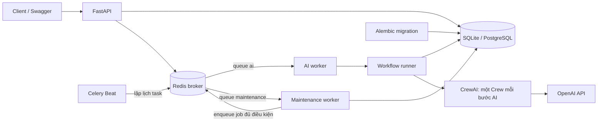
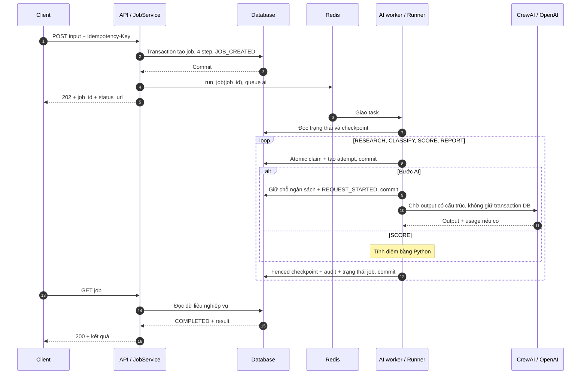
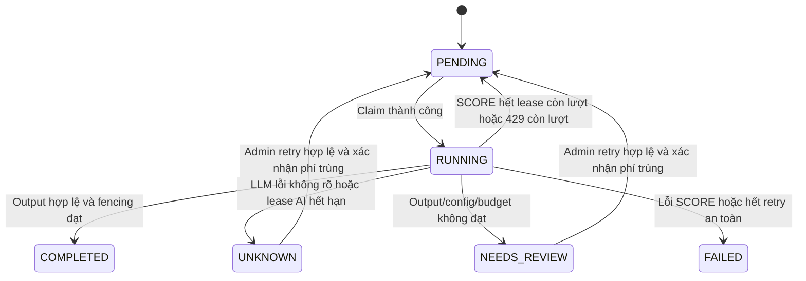

# Luồng end to end: các service tích hợp và xử lý tình huống

Tài liệu này giải thích **hành vi của mã nguồn hiện tại**, từ khi API nhận dữ liệu đến khi trả báo cáo, bao gồm các nhánh lỗi, phục hồi và giới hạn còn lại. Các giá trị mặc định nêu bên dưới lấy từ `settings.py`; `.env` và cấu hình Compose có thể ghi đè chúng.

Đọc tài liệu này không cần khởi động hệ thống. Các JSON, ID và timeline minh họa không phải kết quả gọi OpenAI thực tế.

## Mục lục

1. [Bản đồ service và trách nhiệm](#services)
2. [Khởi động và cấu hình](#startup)
3. [API nhận, kiểm tra và lưu dữ liệu](#api)
4. [Đưa job vào Redis và nhận task](#queue)
5. [Worker chạy pipeline, claim và heartbeat](#worker)
6. [Từng bước AI và chấm điểm](#steps)
7. [Lưu checkpoint và hoàn tất job](#checkpoint)
8. [Client đọc kết quả và các trạng thái](#state)
9. [Chi phí và giới hạn retry](#budget)
10. [Beat, maintenance và khôi phục](#recovery)
11. [Ma trận tình huống và cách xử lý](#cases)
12. [Async, DDD và database](#architecture)
13. [Quan sát, vận hành, kiểm thử và giới hạn](#operations)
14. [Bản đồ mã nguồn](#code-map)

<a id="services"></a>

## 1. Bản đồ service và trách nhiệm



| Thành phần | Làm gì? | Không chịu trách nhiệm gì? |
|---|---|---|
| Client / Swagger | Gửi dữ liệu, giữ `Idempotency-Key`, poll kết quả; người vận hành quyết định retry khi cần | Không gọi trực tiếp CrewAI hoặc sửa trạng thái bước |
| `migrate` | Chạy `alembic upgrade head` một lần khi khởi động bằng Compose | Không chạy nghiên cứu, không xóa/tạo lại toàn bộ dữ liệu |
| `api` | Kiểm tra HTTP/input, gọi application use case, lưu job, publish task, đọc kết quả | Không chạy pipeline trong request HTTP |
| Redis | Chuyển message từ producer đến worker theo queue | Không phải nơi xác nhận job hoàn tất |
| `ai-worker` | Nhận task `run_job(job_id)`, tạo runtime async và chạy workflow | Không tự bỏ qua claim/checkpoint để gọi LLM |
| Workflow runner | Quyết định bước tiếp theo, kiểm tra checkpoint/hash, claim, gọi adapter, lưu kết quả và phân loại lỗi | Không xem trạng thái Celery là trạng thái nghiệp vụ |
| CrewAI adapter | Tạo một Crew/Agent/Task cho từng bước AI, gọi OpenAI và đọc output có cấu trúc | Không có quyền tự thao tác DB, shell, crawler hoặc điều phối recovery |
| OpenAI | Sinh kết quả theo prompt/schema từ dữ liệu được gửi | Không bảo đảm dữ liệu doanh nghiệp ngoài đời là chính xác |
| `beat` | Theo lịch, gửi task bảo trì vào queue `maintenance` | Không tự quét DB hay trực tiếp khôi phục job |
| `maintenance-worker` | Thực thi stale scan, enqueue job chờ và dọn audit event cũ | Không tự gọi lại LLM có kết quả không xác định |
| Database | Lưu job, bước, attempt, sự kiện và kết quả; thực thi unique constraint, transaction và fencing | Không tự gọi OpenAI hay tự publish message |

**Database là nguồn sự thật của nghiệp vụ.** Khi client hỏi kết quả, API đọc database; không hỏi Celery result backend. Dự án không cấu hình result backend để phục vụ polling.

### Một job không tương đương một message cho mỗi bước

Hiện tại, một message chứa `job_id` gọi **một task chạy vòng lặp cả bốn bước**:

```text
run_job(job_id)
  └─ run_workflow(...)
       ├─ RESEARCH → checkpoint
       ├─ CLASSIFY → checkpoint
       ├─ SCORE    → checkpoint
       └─ REPORT   → checkpoint + hoàn tất job
```

Không có Celery chain `research_task → classify_task → ...`. Khi phục hồi, hệ thống gửi lại `run_job(job_id)`; runner dùng checkpoint để biết phần nào đã xong.

<a id="startup"></a>

## 2. Khởi động trước khi nhận request

### 2.1. Cấu hình và lựa chọn database

`Settings` đọc biến môi trường và `.env`. Trong cùng một tiến trình, `get_settings()` có cache; thay `.env` cần khởi động lại tiến trình hoặc tạo lại container.

| Chạy trực tiếp trên host | Chạy trong Compose |
|---|---|
| `DATABASE_URL` có giá trị thì dùng URL đó | Compose đặt `DATABASE_URL` từ `CONTAINER_DATABASE_URL` |
| Nếu URL trống, chọn bằng `DB_BACKEND` | Nếu URL container trống, chọn bằng `DB_BACKEND` và các biến thành phần |
| PostgreSQL dùng `POSTGRES_HOST` | Compose đặt host PostgreSQL từ `CONTAINER_POSTGRES_HOST`, mặc định `host.docker.internal` |
| Redis dùng `REDIS_URL` | Compose đặt Redis URL từ `CONTAINER_REDIS_URL` |

Hai driver được hỗ trợ là `sqlite+aiosqlite` và `postgresql+asyncpg`. URL SQLite/PostgreSQL dạng cũ không ghi driver async được chuẩn hóa khi đọc cấu hình. `URL.create` ghép các biến PostgreSQL để xử lý ký tự đặc biệt trong thông tin đăng nhập.

Mặc định SQLite dùng `./data/ai_research.db`. Trong container, working directory `/app` làm đường dẫn này trở thành `/app/data/ai_research.db`, nằm trong volume `app-data` dùng chung giữa các service ứng dụng.

Chọn PostgreSQL nghĩa là các service kết nối cùng PostgreSQL đã cấu hình; không tự di chuyển job từ file SQLite sang PostgreSQL.

### 2.2. Thứ tự trong Compose

Thứ tự tự động dưới đây áp dụng cho file tổng hợp `docker-compose.yml`. Khi chạy `docker-compose.<service>.yml` riêng, mỗi file chỉ chứa một service: bạn phải chạy migration thành công trước khi khởi động API/worker/Beat. Tất cả file vẫn dùng chung project/network/volume. Xem [lệnh chạy từng service](compose-services.vi.md).

1. `migrate` chạy và phải thoát thành công.
2. API, AI worker, maintenance worker và Beat mới được khởi động.
3. API có healthcheck gọi `/ready`.
4. Worker đăng ký task và lắng nghe queue tương ứng.
5. Beat bắt đầu lập lịch các task bảo trì.

Các service ứng dụng có `restart: unless-stopped`, `init: true` và thời gian chờ dừng 120 giây. `migrate` là service một lần, không tự lặp lại vô hạn nếu migration lỗi.

Redis bên ngoài của bạn được sử dụng mặc định. Redis và PostgreSQL đóng gói trong repo chỉ khởi động khi bật profile tương ứng; nếu chọn chúng, cần khởi động và chờ DB/broker sẵn sàng trước khi chạy ứng dụng. Compose không tự suy ra việc cần bật các profile này từ `DB_BACKEND`.

Mỗi service chạy bằng Dockerfile riêng và script `.sh`; xem [bảng lệnh khởi động](#code-map).

<a id="api"></a>

## 3. API nhận dữ liệu: từ HTTP đến job bền vững

### 3.1. Request minh họa

```http
POST /api/v1/research/jobs
Idempotency-Key: acme-research-v1
Content-Type: application/json
```

```json
{
  "company_name": "Acme CRM",
  "website": "https://example.com",
  "company_description": "Acme provides B2B SaaS CRM software for SMEs in Vietnam.",
  "website_text": "",
  "icp": "B2B SaaS serving SMEs in Vietnam"
}
```

`icp` là chân dung khách hàng lý tưởng dùng để đối chiếu, không phải nguồn chứng cứ về doanh nghiệp. `website_text` là nội dung người dùng tự cung cấp. `website` chỉ là URL tham chiếu; không có crawler tự mở URL đó.

### 3.2. Các lớp kiểm tra

| Lớp | Kiểm tra | Khi không đạt |
|---|---|---|
| Middleware kích thước | Đọc body có giới hạn, kể cả khi request truyền theo chunk; mức giới hạn là `MAX_INPUT_CHARS × 6 + 4096` byte | `413 PAYLOAD_TOO_LARGE` |
| FastAPI/Pydantic | JSON và kiểu dữ liệu, trường bắt buộc, URL HTTP/HTTPS, giới hạn từng trường, không chấp nhận trường dư | `422` |
| Header | Có `Idempotency-Key`, dài từ 1 đến 200 ký tự | `422` |
| Route | Tổng độ dài các giá trị sau chuẩn hóa không vượt `MAX_INPUT_CHARS`, mặc định 6000 ký tự | `422 INPUT_TOO_LONG` |
| Repository | Kiểm tra cùng key có cùng request hash không | `409 IDEMPOTENCY_KEY_CONFLICT` nếu khác |

Giới hạn trường: tên doanh nghiệp 200 ký tự, mô tả và website text mỗi trường 20.000, ICP 2.000. Đây là giới hạn từng trường; vẫn phải qua giới hạn tổng 6000 mặc định. Tên, mô tả và ICP được trim khoảng trắng và phải còn ít nhất một ký tự.

API tự sinh UUID cho `X-Request-ID` và trả ở response. Hiện tại không dùng giá trị `X-Request-ID` do client gửi để nối trace sang worker; ID xuyên suốt nghiệp vụ là `job_id`.

### 3.3. Chuẩn hóa và idempotency

Route dùng `body.model_dump(mode="json")`. Vì vậy, URL được chuyển về dạng JSON của Pydantic và các giá trị mặc định được điền: chẳng hạn `website_text` bỏ trống được chuẩn hóa thành chuỗi rỗng.

Request hash được tính bằng SHA-256 của JSON có key được sắp xếp, bỏ khoảng trắng định dạng và giữ Unicode. Đổi thứ tự key JSON không tạo request hash mới. Đây là so sánh dữ liệu đã chuẩn hóa, không phải so sánh ý nghĩa câu chữ.

```text
Chưa có key
  → tạo job mới

Đã có key + cùng request hash
  → trả job cũ, HTTP 200
  → không tạo thêm bước, không publish lại từ nhánh này

Đã có key + khác request hash
  → HTTP 409
```

Không coi hai request là trùng chỉ vì cùng tên doanh nghiệp. Muốn nghiên cứu lại một cách có chủ đích, dùng key mới.

### 3.4. Transaction tạo job

Trong một transaction, repository:

1. Thêm `ai_jobs`: UUID, key unique, request hash, input JSON, trạng thái `PENDING`, timestamp và chi phí ban đầu.
2. Flush để kiểm tra constraint và lấy các giá trị mặc định.
3. Thêm bốn hàng `ai_steps`, đều `PENDING`, unique theo `(job_id, step_name)`.
4. Thêm event `JOB_CREATED`.
5. Commit toàn bộ trước khi publish message.

Nếu hai request cùng key đến đồng thời, unique constraint quyết định bản ghi thắng. Transaction thua rollback, đọc job đã có rồi so request hash. Cơ chế không dựa vào một lần `SELECT` kiểm tra trước khi insert.

Repository trả đối tượng domain `ResearchJob` thay vì ORM object. DB session đã đóng khi application tiếp tục publish.

### 3.5. Response có nghĩa gì?

```json
{
  "job_id": "<uuid-cua-job>",
  "status": "PENDING",
  "status_url": "/api/v1/research/jobs/<uuid-cua-job>"
}
```

HTTP `202` xác nhận **job đã được lưu thành công và được chấp nhận xử lý bất đồng bộ**. Nó không xác nhận OpenAI đã được gọi, worker đang chạy hay message chắc chắn đã publish thành công.

Worker có thể chạy rất nhanh sau publish; response tạo job vẫn là snapshot lúc tạo, còn lần GET tiếp theo có thể đã thấy `RUNNING` hoặc trạng thái mới hơn.

<a id="queue"></a>

## 4. Từ application đến Redis và AI worker

### 4.1. Publish

`JobService.create()` gọi publisher chỉ với job mới. Publisher thực hiện:

```python
run_job.apply_async(args=[job_id], queue="ai")
```

Celery thêm metadata vận chuyển riêng; đối số nghiệp vụ chỉ có `job_id`. Toàn bộ mô tả, ICP và checkpoint được giữ ở database, không nhét vào message nghiệp vụ.

Celery publisher là API đồng bộ nên được bọc bằng `asyncio.to_thread`. Event loop FastAPI không bị giữ trong lúc chờ thao tác publish đồng bộ.

### 4.2. Publish thất bại sau khi đã commit DB

`JobService._enqueue()` bắt lỗi publish, ghi log `ENQUEUE_DEFERRED` rồi vẫn trả job đã lưu cho client. Không rollback job đã commit, không gọi LLM ngay tại API.

Sau khi Redis và các service bảo trì hoạt động trở lại, `resume_pending_jobs` có thể phát hiện job còn đủ điều kiện và enqueue lại. Đây là cách bù cho khoảng trống **commit DB → publish Redis**; hiện chưa có transactional outbox.

Nếu publish đã thành công nhưng producer không nhận được xác nhận và gửi lại, queue có thể chứa message trùng. Claim trong DB vẫn là cổng quyết định ai được thực thi bước.

### 4.3. Các cấu hình Celery liên quan

| Cấu hình hiện tại | Ý nghĩa đối với luồng này |
|---|---|
| `task_acks_late=True` | ACK được đặt theo cơ chế late acknowledgement, sau quá trình xử lý task thông thường |
| `task_reject_on_worker_lost=False` | Không bật cơ chế tự reject/requeue khi mất worker; không dựa riêng vào redelivery để phục hồi |
| `worker_prefetch_multiplier=1` | Hạn chế số message được lấy trước |
| `worker_concurrency=1`, script dùng `--pool=solo` | Mô hình local ít worker, giảm tranh chấp SQLite |
| `task_ignore_result=True`, không cấu hình result backend | Kết quả nghiệp vụ phải lấy từ DB |
| JSON serializer và `accept_content=["json"]` | Chỉ nhận định dạng task đã cấu hình |
| Redis `visibility_timeout=3600` giây | Message chưa được ACK có thể được broker đưa lại sau khoảng này; không phải deadline job |
| Publish retry tối đa 2 lần | Retry việc gửi message, hoàn toàn khác retry OpenAI |

Worker kết nối lại broker khi khởi động theo cấu hình Celery. Thời điểm phát lại message còn tùy loại lỗi và cơ chế broker; luồng an toàn vẫn cần scanner, checkpoint và fencing.

<a id="worker"></a>

## 5. Worker nhận task và bắt đầu workflow

### 5.1. Runtime của một task

```text
AI worker nhận run_job(job_id)
  → task entrypoint đồng bộ
  → runtime.run_async(...)
  → asyncio.run(...)
  → tạo Database + Repository trong phạm vi task
  → await run_workflow(job_id, repo, adapter, settings)
  → await engine.dispose()
  → đóng event loop của lần thực thi
```

Không tái sử dụng một async engine toàn cục qua nhiều event loop hoặc process. Maintenance task cũng dùng runtime này.

### 5.2. Đọc DB và quyết định có được chạy không

Runner đọc job và bốn step theo thứ tự `RESEARCH → CLASSIFY → SCORE → REPORT`.

| Trạng thái đầu vào | Hành động |
|---|---|
| Không có job | Thoát, không gọi LLM |
| Job `COMPLETED`, `FAILED`, `NEEDS_REVIEW` | Thoát; `can_execute` chỉ cho phép `PENDING`/`RUNNING` |
| Bước `COMPLETED` và hash hợp lệ | Tái sử dụng output, tiếp tục vòng lặp |
| Bước `COMPLETED` nhưng hash không khớp | Đưa job về `NEEDS_REVIEW`, mã `CHECKPOINT_VERSION_MISMATCH`; dừng |
| Bước `UNKNOWN`/`NEEDS_REVIEW` trong job còn được chạy | Đánh dấu job cần kiểm tra rồi dừng |
| Bước không claim được | Thoát; không tự gọi provider để thử vận may |

Job đã `COMPLETED` được bỏ qua ngay; runner không kiểm tra lại hash toàn bộ job hoàn tất ở mỗi redelivery hay mỗi GET. Kiểm tra hash checkpoint xảy ra khi tiếp tục một job còn được phép chạy.

### 5.3. Input hash của bước

Trước khi claim hoặc tái sử dụng checkpoint, runner dựng input của bước và tính hash.

Với bước AI, hash chứa tên bước, payload, schema/version, prompt/version, model, temperature, output token limit, agent iteration limit, request timeout và adapter version. Với SCORE, hash chứa payload, schema/version và rules version.

Payload các bước sau chứa dữ liệu checkpoint trước đó cần thiết cho bước đó. Vì runner kiểm tra tuần tự, checkpoint phía trước không hợp lệ sẽ chặn việc tiếp tục phía sau.

`output_hash` là SHA-256 của JSON output; khi resume, runner cũng so lại hash này. Cơ chế không phải bộ kiểm tra tính toàn vẹn DB chạy nền liên tục.

Hash không tự phản ánh mọi thay đổi mã nguồn Python. Khi thay logic scoring, người phát triển phải cập nhật rules version tương ứng; không nên coi một hằng version chưa đổi là bằng chứng hai phiên bản code có cùng hành vi.

### 5.4. Claim nguyên tử

Trong transaction claim:

1. Đọc hàng step cần claim.
2. Khóa hàng job bằng no-op update `updated_at = updated_at`.
3. Conditional update step, chỉ khi tất cả điều kiện đạt.
4. Tạo attempt mới và event `STEP_CLAIMED`.
5. Đặt job `RUNNING`, xóa lỗi cũ ở job và commit.

Điều kiện claim:

```text
step.status == PENDING
attempt_count < MAX_STEP_ATTEMPTS
next_retry_at chưa có hoặc đã đến hạn
job.status thuộc PENDING / RUNNING
mọi bước đứng trước đều COMPLETED
```

Khi thắng claim, step nhận token UUID mới, input hash, lease expiry, timestamp bắt đầu và `attempt_count + 1`. Attempt chứa `attempt_id`, số thứ tự attempt và cùng lease token.

Hai worker nhận cùng job không thể cùng thắng claim của một bước. Worker thua nhận kết quả không claim được và thoát. Worker khác có thể tiếp tục bước kế tiếp sau khi checkpoint trước đã commit; mọi bước vẫn phải qua cùng cổng claim.

### 5.5. Lease và heartbeat

Lease mặc định 300 giây. Heartbeat chạy trong một asyncio task, khoảng cách giữa các lần là `max(1, LEASE_TTL_SECONDS / 3)`, tức mặc định 100 giây.

Heartbeat có session/transaction riêng. Nó chỉ gia hạn khi step vẫn `RUNNING`, token/input hash còn khớp và lease **chưa hết hạn**. Worker không thể hồi sinh một lease đã hết hạn.

Khi scope xử lý bước kết thúc, runner cancel và chờ heartbeat dừng. Nếu worker/process chết, heartbeat cũng không tiếp tục gia hạn.

Nếu heartbeat gặp lỗi DB hoặc không còn quyền sở hữu, task heartbeat dừng. Code hiện tại không lập tức cancel cuộc gọi provider đang chạy; kết quả sau đó vẫn phải qua fencing và có thể bị loại bỏ. Vì vậy fencing bảo vệ checkpoint, không bảo đảm tiết kiệm được khoản phí của request đã gửi.

### 5.6. Trước một cuộc gọi AI

Runner ước tính chi phí rồi gọi `request_started()` trong một transaction mới:

1. Khóa job, kiểm tra fencing của step.
2. Attempt phải còn `CLAIMED`; gọi lặp lại cho cùng attempt không được ghi nhận thêm lần bắt đầu.
3. Đếm attempt của job có `llm_started_at` khác null.
4. Kiểm tra trần số lần gọi và chi phí giữ chỗ.
5. Nếu đạt: attempt → `REQUEST_STARTED`, ghi `llm_started_at`, giữ chỗ chi phí, thêm event `LLM_REQUEST_STARTED` rồi commit.
6. Session đóng; lúc này mới gọi adapter/provider.

`REQUEST_STARTED` là dấu mốc phía hệ thống trước khi gọi ra ngoài. Worker vẫn có thể chết ngay sau commit và trước lúc gửi request. Không thể suy ra chắc chắn provider đã xử lý hay đã tính phí từ dấu mốc này.

<a id="steps"></a>

## 6. Dữ liệu đi qua bốn bước như thế nào?

| Bước | Input thực tế do runner dựng | Output checkpoint |
|---|---|---|
| RESEARCH | `company_name`, `company_description`, `website_text` | Tên, ngành nghề, sản phẩm, nhóm khách hàng, `evidence`, `limitations` |
| CLASSIFY | Research checkpoint + `icp` | `icp_match`, `matching_signals`, `missing_signals`, `reasoning` |
| SCORE | Research + classification checkpoint | Điểm, từng quy tắc được cộng điểm, xếp hạng, ghi chú nguồn |
| REPORT | Input job + toàn bộ checkpoint trước | Tóm tắt, điểm mạnh, rủi ro, câu hỏi tiếp theo, ghi chú nguồn |

RESEARCH không nhận ICP làm nguồn suy diễn và không nhận URL website trong payload bước này. REPORT nhận input job có URL nhưng vẫn không có công cụ duyệt web.

### 6.1. RESEARCH

Prompt yêu cầu chỉ trích xuất từ nội dung được cung cấp và nêu hạn chế dữ liệu. Code kiểm tra mỗi chuỗi `evidence` có xuất hiện nguyên văn trong:

```text
company_description + ký tự xuống dòng + website_text
```

Không tìm thấy dẫn chứng → `InvalidOutput`, dừng để kiểm tra. Danh sách evidence có thể rỗng theo schema; code không biến sự thiếu dữ liệu thành bằng chứng tích cực.

### 6.2. CLASSIFY

Prompt đối chiếu research với ICP. Code kiểm tra:

- Mỗi `matching_signals` là một chuỗi con của ít nhất một research evidence.
- Nếu `icp_match=true`, phải có ít nhất một matching signal.

Trích dẫn hợp lệ không chứng minh suy luận ICP là đúng. Đây là ràng buộc nguồn, còn đánh giá ngữ nghĩa vẫn do LLM thực hiện.

### 6.3. SCORE

Không gọi OpenAI và không giữ chỗ chi phí AI. Hàm Python ghép các evidence rồi kiểm tra tín hiệu:

| Quy tắc | Điều kiện hiện tại | Điểm |
|---|---|---:|
| `b2b_saas` | Evidence có tín hiệu B2B/business-to-business và SaaS/software-as-a-service/subscription theo regex | 40 |
| `icp_match` | Classification có `icp_match=true` sau khi qua kiểm tra nguồn | 30 |
| `sme_target` | Evidence có từ khóa SME/SMEs hoặc các cụm tiếng Anh được cấu hình trong regex | 20 |
| `clear_product` | Ít nhất một tên sản phẩm, không phân biệt hoa thường, xuất hiện trong chuỗi evidence đã ghép | 10 |

`HIGH`: từ 70 điểm; `MEDIUM`: từ 40 đến dưới 70; `LOW`: dưới 40. `rule_breakdown` cho biết điểm được cộng, tín hiệu hỗ trợ và evidence. Ghi chú mang theo các missing signal.

Ví dụ, nếu các checkpoint minh họa xác nhận đủ bốn điều kiện thì tổng là 100. Đó không phải kết quả được bảo đảm cho mọi request có câu mô tả tương tự, vì RESEARCH/CLASSIFY còn phụ thuộc output LLM.

Quy tắc regex hiện tại còn đơn giản: không tự hiểu phủ định như “not B2B SaaS” và không bao phủ mọi cách diễn đạt tiếng Việt. Điểm là ước tính theo quy tắc, không phải chứng nhận chất lượng hay dữ liệu doanh nghiệp đã xác minh.

### 6.4. REPORT

Crew tổng hợp các checkpoint thành báo cáo có cấu trúc. Prompt yêu cầu giữ hạn chế, missing signal và mô tả nguồn do người vận hành cung cấp. Code kiểm tra schema/độ dài; không có một bộ kiểm chứng thực tế độc lập cho từng câu trong báo cáo.

### 6.5. Bên trong một Crew AI

Mỗi bước AI có một Crew, một Agent, một Task:

```text
await adapter.execute(step, payload)
  → AsyncOpenAI(timeout=..., max_retries=0)
  → BaseLLM có cổng một request
  → Agent + Task(output_pydantic=Schema)
  → await crew.akickoff()
  → await client.chat.completions.create(...)
  → kiểm tra finish_reason, refusal, JSON và schema
  → AIResult(output, token usage, provider request ID nếu có)
```

Các giới hạn: không tools, không delegation, không code execution, không memory/cache, không tracing; agent retry và guardrail retry bằng 0. OpenAI response dùng JSON schema strict, temperature và output token limit theo cấu hình.

Cổng SDK chỉ cho một request trong mỗi Crew; các lần lặp/sửa định dạng bên trong thư viện không được tự phát sinh thêm request trả phí. `MAX_AGENT_ITERATIONS` không phải số request OpenAI được phép gọi tự do.

Provider messages được tạo từ system instruction cố định và JSON evidence ở user message. Adapter không lấy prompt sửa lỗi tùy ý do framework sinh ra để làm một request provider mới.

Schema AI không nhận field dư, kiểm tra kiểu strict; chuỗi ngắn dài 1–1200 ký tự, danh sách các mục tối đa 12 phần tử. Response bị từ chối hoặc bị cắt vì giới hạn output được coi là output không hợp lệ, không tự gọi lại để sửa.

CrewAI bản đang dùng vẫn gọi một hook sync từ thread trong executor async. Adapter dùng `run_coroutine_threadsafe` để chạy `acall` trên event loop sở hữu `AsyncOpenAI`. Nếu hook sync được gọi ngay trên loop đó, adapter chặn để tránh deadlock. Network provider vẫn dùng client async.

<a id="checkpoint"></a>

## 7. Lưu checkpoint và hoàn tất job

### 7.1. Transaction hoàn tất một bước

Sau khi có output hợp lệ, repository khóa job rồi conditional update step với đủ điều kiện:

```sql
WHERE id = :step_id
  AND status = 'RUNNING'
  AND lease_token = :token
  AND input_hash = :expected_input_hash
  AND lease_expires_at > :now
```

Đây là fencing. Token khớp nhưng lease đã hết hạn vẫn không được ghi, kể cả scanner chưa kịp chạy.

Nếu update được đúng một hàng, trong cùng transaction:

1. Step → `COMPLETED`, lưu `output_json`, `output_hash`, thời gian hoàn tất; xóa token/lease đang giữ.
2. Attempt → `SUCCEEDED`, lưu thời gian kết thúc, token usage và provider request ID nếu có.
3. Điều chỉnh chi phí giữ chỗ bằng chi phí ước tính theo usage khi có đủ token input/output.
4. Thêm `STEP_CHECKPOINTED`.
5. Nếu cả bốn bước đều hoàn tất: job → `COMPLETED`, lưu kết quả tổng hợp, timestamp và event `JOB_COMPLETED`.
6. Commit.

Nếu update không được hàng nào, runner ghi `STALE_RESULT_DISCARDED` rồi thoát. Không ghi đè checkpoint hoặc tự nhận lại quyền sở hữu.

### 7.2. Bước kế tiếp được kích hoạt bằng cách nào?

Các step đã tồn tại ở `PENDING` từ lúc tạo job. Không cần tạo task mới sau mỗi checkpoint. Sau commit, runner tiếp tục vòng lặp; bước kế tiếp chỉ claim được khi mọi predecessor đều `COMPLETED`.

Nếu worker chết sau checkpoint, dữ liệu đã commit vẫn còn. Khi job được gửi lại, runner kiểm tra hash, lấy checkpoint cũ và bỏ qua lần gọi AI cho bước đã hoàn tất.

### 7.3. Sequence thành công



Heartbeat có thể xen vào bằng các transaction riêng trong lúc chờ provider; sơ đồ không vẽ từng lần heartbeat.

<a id="state"></a>

## 8. Client đọc kết quả và hiểu trạng thái

### 8.1. Polling

Client gọi `GET /api/v1/research/jobs/{job_id}` và đọc:

- `status` cấp job; thời gian tạo/cập nhật/hoàn tất.
- `steps` theo thứ tự pipeline, gồm status, attempt count, timestamp và output đã checkpoint.
- `error` chứa mã lỗi và thông báo làm sạch khi có lỗi.
- `estimated_cost_usd`.
- `result` tổng hợp khi hoàn tất: `research`, `classify`, `score`, `report`.

Các HTTP GET đọc DB, không làm job chạy lại. Job chưa biết trả `404 JOB_NOT_FOUND`. Có thể poll vài giây một lần; đây là lựa chọn client, chưa có WebSocket, webhook hay thông báo đẩy.

Job đang chạy vẫn có thể trả các output đã checkpoint. Một lần poll chỉ mô tả trạng thái tại lúc đọc; trong khi worker đang ghi, client nên đọc lại để thấy tiến độ mới nhất.

### 8.2. Trạng thái job

| Trạng thái | Ý nghĩa và hành động thông thường |
|---|---|
| `PENDING` | Chờ claim, chờ safe retry hoặc vừa được admin reset để retry |
| `RUNNING` | Có tiến trình workflow đang/đã bắt đầu xử lý; có thể đang ở khoảng giữa hai checkpoint |
| `COMPLETED` | Bốn bước đã hoàn tất và kết quả tổng hợp đã lưu |
| `NEEDS_REVIEW` | Có kết quả không rõ, output/cấu hình không hợp lệ, vượt budget hoặc checkpoint không tương thích |
| `FAILED` | Lỗi thực thi SCORE theo nhánh exception chung, hoặc đã cạn chính sách retry an toàn tương ứng |

`RUNNING` không tự chứng minh có worker sống. Phải đối chiếu lease/heartbeat và scanner để phát hiện worker đã mất.

### 8.3. Trạng thái bước và attempt

| Đối tượng | Các trạng thái được dùng |
|---|---|
| Step | `PENDING`, `RUNNING`, `COMPLETED`, `FAILED`, `UNKNOWN`, `NEEDS_REVIEW` |
| Attempt | `CLAIMED`, `REQUEST_STARTED`, `SUCCEEDED`, `FAILED`, `UNKNOWN` |

Một step có nhiều attempt. Retry tạo attempt mới khi claim tiếp theo thành công; không xóa attempt trước và không reset `attempt_count` về 0.



Sơ đồ mô tả trạng thái bước, không gộp với job/attempt. Nhánh `429` có cập nhật lỗi và audit trước khi trả về `PENDING` trong cùng transaction; quan sát cuối transaction có thể thấy `PENDING` chứ không thấy trạng thái `FAILED` trung gian.

<a id="budget"></a>

## 9. Chi phí và các tầng retry

### 9.1. Cách giữ chỗ chi phí

Trước mỗi bước AI:

```text
Ước lượng input = số byte UTF-8 JSON messages + JSON schema + 1024 dự phòng

Khoản giữ chỗ USD =
  (ước lượng input × đơn giá input / 1.000.000)
  + (MAX_OUTPUT_TOKENS_PER_STEP × đơn giá output / 1.000.000)
```

Đây là ước tính thận trọng, không phải tokenizer chính xác hoặc hóa đơn. Mặc định ngân sách job là 0,20 USD; đơn giá là biến cấu hình và phải phù hợp với model/tài khoản của bạn.

Khi có usage thành công, chi phí ước tính theo token thực tế thay thế khoản giữ chỗ. Nếu thiếu usage, giữ ước tính. Nếu output lỗi/timeout/kết quả không rõ, khoản đã giữ không tự được hoàn lại. Với `429` được phân loại là từ chối an toàn, khoản giữ chỗ của attempt được giải phóng.

Thiếu API key được phát hiện trong adapter, **sau** bước ghi `REQUEST_STARTED`. Vì vậy trong code hiện tại, case thiếu key có thể có lần bắt đầu và khoản giữ chỗ trong DB dù chưa phát sinh request provider thực tế. Metrics/cost của dự án không phải sổ billing chính xác.

### 9.2. Hai trần độc lập

| Trần | Mặc định | Tính gì? |
|---|---:|---|
| `MAX_STEP_ATTEMPTS` | 3 | Số lần claim thành công cho mỗi step, kể cả attempt chết trước khi gọi provider |
| `MAX_LLM_CALLS_PER_JOB` | 3 | Số attempt toàn job có `llm_started_at`, gồm lần bị `429` và retry thủ công |
| `MAX_ESTIMATED_USD_PER_JOB` | 0,20 | Tổng chi phí ước tính hiện tại cộng khoản chuẩn bị giữ chỗ |

Một job bình thường cần ba bước AI. Với trần mặc định ba lần, một `429` đã được tính là lần bắt đầu có thể khiến job hết quota trước REPORT, dù bước đó còn lượt retry. Muốn cho phép thêm lần thử, người vận hành phải chủ động tăng trần phù hợp, khởi động lại service và kiểm tra trạng thái trước khi retry.

Nếu vượt trần trước call, step/job đi về `NEEDS_REVIEW`, mã `BUDGET_EXCEEDED`; không gửi call đó ra provider.

### 9.3. Phân biệt các retry

| Tầng | Chính sách |
|---|---|
| DB transaction | Tối đa 4 lần thực hiện callback khi lỗi SQLite locked hoặc PostgreSQL `40001`/`40P01`; chờ tăng dần 0,025 / 0,05 / 0,1 giây giữa các lượt, ngoài thời gian DB tự chờ |
| Broker publish | Theo policy Celery, tối đa 2 lần retry publish; có thể tạo message trùng |
| Redis redelivery | Có thể giao lại task; vẫn qua claim và checkpoint |
| SDK OpenAI | `max_retries=0` |
| Agent/guardrail | Retry bằng 0, cộng cổng một SDK request mỗi Crew |
| Provider `429` | Lưu trạng thái retry trong DB nếu còn attempt; không dùng Celery autoretry |
| Provider timeout/kết quả không rõ | Không tự retry LLM |
| Admin retry | Yêu cầu token, xác nhận khả năng tính phí trùng và còn đủ giới hạn |

Database chỉ replay callback DB cho các nhóm lỗi có rollback xác định được hỗ trợ; không tự replay lỗi kết nối/commit không rõ. Callback không chứa LLM hay publish broker.

<a id="recovery"></a>

## 10. Beat và maintenance phục hồi thế nào?

### 10.1. Lịch hiện tại

| Task | Lịch | Nơi thực thi |
|---|---|---|
| `scan_stale_steps` | Mỗi `RECOVERY_SCAN_SECONDS`, mặc định 60 giây | Maintenance worker |
| `resume_pending_jobs` | Cùng chu kỳ, mặc định 60 giây | Maintenance worker |
| `cleanup_old_job_events` | 02:00 UTC hằng ngày, tức 09:00 giờ Việt Nam | Maintenance worker |

Beat chỉ publish các task theo lịch. Nếu maintenance worker không chạy, task có thể nằm trong queue nhưng DB chưa được quét. Nếu Redis không hoạt động, Beat cũng không có đường gửi task bảo trì; recovery phải chờ hạ tầng này được khôi phục.

### 10.2. Quét lease hết hạn

Mỗi lượt mặc định lấy tối đa 100 step `RUNNING` có `lease_expires_at <= now`, sắp xếp ổn định theo job/step. Với từng step, khóa job rồi conditional update lại điều kiện hết hạn.

| Step hết lease | Trạng thái step | Trạng thái attempt | Trạng thái job |
|---|---|---|---|
| RESEARCH / CLASSIFY / REPORT | `UNKNOWN` | `UNKNOWN` | `NEEDS_REVIEW` |
| SCORE còn attempt | `PENDING` | `FAILED` | `PENDING` |
| SCORE hết attempt | `FAILED` | `FAILED` | `FAILED` |

Scanner xóa lease ownership, ghi `LEASE_EXPIRED` và `STEP_UNKNOWN` hoặc `STEP_RECOVERED`. Hai scanner chạy chồng nhau không được chuyển cùng hàng hai lần nhờ điều kiện update. Nếu worker vừa checkpoint hoặc heartbeat gia hạn trước update của scanner, hàng không còn thỏa điều kiện sẽ được bỏ qua.

Ngay cả khi crash trước khi ghi `REQUEST_STARTED`, lease của bước AI hết hạn vẫn được xử lý bảo thủ thành `UNKNOWN`. Scanner hiện không có nhánh tự chứng minh request chưa gửi để chạy lại.

### 10.3. Tìm job có thể tiếp tục

`list_resumable_jobs()` mặc định lấy tối đa 100 job, ưu tiên `updated_at` cũ:

```text
job.status là PENDING hoặc RUNNING
có bước PENDING còn attempt và đã đến hạn
không có bước RUNNING / UNKNOWN / NEEDS_REVIEW / FAILED
không có bước PENDING đang chờ next_retry_at hoặc đã cạn attempt
```

Maintenance publish lại `run_job(job_id)` cho các job đó. Nếu publish thất bại, log `RECOVERY_ENQUEUE_DEFERRED`; job vẫn còn trong DB cho lượt sau.

Hai lượt resume có thể enqueue cùng job trước khi worker claim. Scanner không đặt một khóa enqueue tồn tại lâu; cơ chế chống thực thi trùng nằm ở claim bước.

`scan_stale_steps` và `resume_pending_jobs` là hai task độc lập, không bảo đảm task nào chạy trước trong một chu kỳ. SCORE vừa được reset hoặc một job vừa có trạng thái phù hợp có thể phải chờ lượt resume tiếp theo.

### 10.4. Safe retry cho `429`

Khi adapter nhận HTTP `429`, runner gọi `safe_retry()`:

1. Fenced failure ghi attempt `FAILED`, loại `PROVIDER_REJECTED`, cập nhật audit.
2. Giải phóng khoản cost đã giữ cho attempt bị từ chối.
3. Nếu còn step attempt: step/job → `PENDING`, đặt `next_retry_at`.
4. Thời gian chờ là `min(300, 2 ** attempt_no)` giây, ví dụ 2 giây sau attempt 1, 4 giây sau attempt 2.
5. Runner thoát; scanner resume mới enqueue khi đến hạn.

Thời gian thực tế thường dài hơn backoff vì còn phụ thuộc chu kỳ Beat, queue và worker. Code hiện không phân loại chi tiết các biến thể `429` theo quota/throttle và không áp dụng `Retry-After` của provider. Khi cạn step attempt, job/step ở `FAILED` và không tự enqueue nữa.

### 10.5. Retry thủ công

```http
POST /api/v1/research/jobs/<job_id>/retry
Authorization: Bearer <ADMIN_TOKEN>
Content-Type: application/json
```

```json
{
  "step_name": "REPORT",
  "acknowledge_possible_duplicate_charge": true
}
```

Các điều kiện phải đồng thời đạt:

- Admin token đã cấu hình và header đúng; không đạt → `401`.
- Job tồn tại; không có → `404`.
- Body hợp lệ và xác nhận đúng literal `true`; không đạt → `422`.
- Bước được chọn là bước chưa hoàn tất đầu tiên.
- Bước đó ở `UNKNOWN` hoặc `NEEDS_REVIEW`, còn step attempt.
- Tất cả bước sau vẫn `PENDING`; không cho giữ một checkpoint phía sau đã tính từ dữ liệu cũ.

Sai điều kiện nghiệp vụ → `409 RETRY_NOT_ALLOWED`. Nếu đạt, trong transaction: khóa job, reset step về `PENDING`, xóa thời gian chờ retry, reset trạng thái/lỗi job, ghi `MANUAL_RETRY_ACKNOWLEDGED`, rồi commit. Sau đó mới publish và trả `202`.

Attempt count, lịch sử attempt và chi phí cũ không được xóa. Lần claim sau mới tạo token/attempt mới và tính lại input hash. Trần số call/chi phí vẫn được kiểm tra ở `request_started`, không được bỏ qua vì có admin token.

**Endpoint hiện không nhận retry cho `FAILED`, `RUNNING` hoặc `COMPLETED`.** Với job `FAILED`, cách API hỗ trợ hiện tại là sửa nguyên nhân rồi tạo job mới bằng key mới. Không sửa trạng thái SQL thủ công như một luồng vận hành thông thường.

`reconcile_unknown_step()` hiện chỉ trả thông tin cần duyệt; không có lookup kết quả đáng tin cậy từ provider và không có endpoint reconciliation tự động. Nếu một checkpoint cũ không tương thích, tạo job mới; reset bước cuối bằng retry không sửa được hash của predecessor đã hoàn tất.

<a id="cases"></a>

## 11. Ma trận tình huống end to end

### 11.1. Từ client đến DB và queue

| Tình huống | Hệ thống làm gì? | Người vận hành/client nên làm gì? |
|---|---|---|
| Thiếu key, input rỗng/sai kiểu, URL không hợp lệ, field dư | Trả `422`, không tạo job hợp lệ | Sửa request |
| Body vượt byte limit | Trả `413` trước khi parse model | Giảm payload |
| Input vượt tổng ký tự | Trả `422 INPUT_TOO_LONG` | Rút ngắn mô tả/website text/ICP |
| Cùng key, cùng payload | Trả job cũ `200`; không publish từ nhánh duplicate | Poll job cũ |
| Cùng key, khác payload | `409 IDEMPOTENCY_KEY_CONFLICT` | Chọn key mới nếu là yêu cầu mới |
| Hai POST cùng key đồng thời | Unique constraint giữ một job; request còn lại so hash | Không cần tự khóa ở client |
| API chết trước khi commit | Transaction không hoàn tất sẽ rollback; client chưa có kết quả chắc chắn | Gửi lại cùng key/payload để đối chiếu |
| API chết sau commit nhưng trước publish/response | Job có thể đã tồn tại ở `PENDING` | Gửi lại cùng key; Beat có thể enqueue phần còn thiếu |
| Redis lỗi sau khi job đã commit | API có thể vẫn trả `202`, log enqueue deferred | Khôi phục Redis, Beat và maintenance worker; giữ key cũ |
| Publish có kết quả không rõ hoặc message trùng | Có thể xuất hiện nhiều delivery; DB claim quyết định | Không đổi key chỉ vì chờ lâu |
| DB lỗi/không truy cập được lúc tạo job | Không có cam kết `202`; lỗi ngoài các nhánh API xử lý có thể thành `500` | Khôi phục DB, gửi lại cùng key để kiểm tra commit đã xảy ra chưa |
| Client mất kết nối sau POST | Job có thể vẫn tiếp tục nếu đã được lưu/publish | Không có API cancel theo HTTP disconnect; dùng cùng key để tìm job |

### 11.2. Khi worker xử lý

| Tình huống | Kết quả và cơ chế bảo vệ |
|---|---|
| Task không tìm thấy job | Runner thoát, không tạo job thay thế |
| Task lặp lại sau khi job hoàn tất | Runner thoát, không gọi thêm LLM |
| Hai worker nhận cùng job | Chỉ một claim thành công cho cùng bước; message còn lại không vượt được cổng DB |
| Bước đang `RUNNING` | Claim chỉ nhận `PENDING`; delivery mới thoát. Lease hết hạn phải chờ scanner chuyển trạng thái |
| Crash sau claim, trước request | AI step hết lease → `UNKNOWN`; SCORE hết lease → retry an toàn nếu còn attempt |
| Crash sau `REQUEST_STARTED`, trước gửi provider | Không thể dùng dấu mốc này để biết remote có chạy; hết lease → `UNKNOWN` |
| Crash trong khi chờ provider | Heartbeat mất theo process; hết lease → `UNKNOWN`; không tự gọi lại AI |
| Provider trả xong, crash trước checkpoint | Output chưa bền vững; hết lease → `UNKNOWN`; retry có thể bị tính phí trùng |
| Crash sau RESEARCH checkpoint | RESEARCH vẫn `COMPLETED`; resume tái sử dụng checkpoint và chạy CLASSIFY |
| Crash giữa hai bước khi job còn `RUNNING` nhưng không có lease active | Resume scanner có thể enqueue vì job còn PENDING work hợp lệ |
| Crash sau REPORT checkpoint/finalization | Output REPORT và job COMPLETED nằm cùng transaction; không cần finalize riêng bằng task khác |
| Lease hết hạn nhưng worker cũ còn chạy | Completion/heartbeat không qua fence; không ghi đè output |
| Scanner đã reset, worker mới có token khác | Token cũ không thể checkpoint vào lần chạy mới |
| Checkpoint hash không khớp lúc resume | Job cần duyệt với `CHECKPOINT_VERSION_MISMATCH`; không gọi tiếp dựa trên checkpoint cũ |
| Coroutine bị cancel hoặc process bị kill trước khi lưu lỗi | Trạng thái có thể còn RUNNING; heartbeat dừng và recovery theo lease là đường xử lý bảo thủ |

### 11.3. Provider, output và ngân sách

| Tình huống | Trạng thái theo implementation hiện tại |
|---|---|
| Thiếu OpenAI API key | `InvalidOutput` → step/job `NEEDS_REVIEW`, mã chung `OUTPUT_OR_CONFIGURATION_INVALID`; có thể đã giữ chỗ cost |
| HTTP `429` | Nhánh safe retry có backoff, còn chịu trần attempt/call/budget |
| Timeout, lỗi kết nối, HTTP `5xx` | Khi đi qua nhánh exception chung của bước AI: `UNKNOWN` và job `NEEDS_REVIEW` |
| HTTP `401`/`403` hoặc status khác `429` | Adapter hiện chưa có phân loại cấu hình riêng; cũng đi theo nhánh bảo thủ `UNKNOWN`, cần kiểm tra quyền/key |
| Provider refusal hoặc output bị cắt | `NEEDS_REVIEW`, không tự request thêm để sửa |
| JSON/schema sai, field dư, kiểu sai hoặc dẫn chứng không hợp lệ | `NEEDS_REVIEW`, mã chung `OUTPUT_OR_CONFIGURATION_INVALID` |
| Crew lỗi không có provider failure đã lưu | Adapter có thể chuyển thành `InvalidOutput`, cần duyệt; không suy diễn mọi lỗi Crew đều đã gọi provider |
| Đã có output nhưng thiếu usage | Nếu output hợp lệ vẫn checkpoint; giữ cost ước tính thay vì đối soát token |
| Vượt call cap hoặc dollar estimate cap | Dừng trước call đó với `BUDGET_EXCEEDED`; không miễn giới hạn khi admin retry |
| SCORE ném exception thông thường ngoài `ValidationError`/`InvalidOutput` | Step/job `FAILED`; không tự retry lỗi logic qua endpoint admin hiện tại |
| Crash/hết lease trong SCORE | Được scanner retry vì tính toán thuần, nếu còn attempt; khác với exception xác định ở dòng trên |

Việc lưu trạng thái lỗi cũng phải qua fencing. Nếu lease đã mất, hoặc DB tiếp tục lỗi khiến không ghi được lỗi, có thể chưa thấy trạng thái cuối ngay; scanner sau khi DB hoạt động lại mới xử lý lease hết hạn. Không có bảo đảm mọi exception đều lập tức trở thành một response/trạng thái đã lưu thành công.

### 11.4. Hạ tầng và vận hành

| Tình huống | Hành vi và cách xử lý |
|---|---|
| Beat dừng | Không có lịch bảo trì mới; pipeline đang chạy vẫn có thể tiếp tục |
| Maintenance worker dừng | Beat có thể gửi task vào queue nhưng chưa có ai quét DB |
| AI worker dừng | Job chờ ở DB/queue; các lease đang chạy sẽ bị scanner đánh giá khi đến hạn |
| Redis dừng trong khi provider đang chạy | Worker đang có job có thể tiếp tục gọi provider và checkpoint DB; publish/ACK/recovery vận chuyển phụ thuộc broker khi quay lại |
| Redis mất message | Pending scan có thể enqueue lại job đủ điều kiện; không tự replay UNKNOWN AI |
| SQLite khóa hoặc PostgreSQL deadlock/serialization lỗi được hỗ trợ | Transaction rollback và retry giới hạn; không replay LLM |
| DB mất kết nối trong lúc provider đang chạy | Heartbeat có thể dừng; checkpoint/lưu lỗi có thể không thực hiện được; phục hồi dựa vào DB và lease sau đó |
| Lỗi kết nối lúc commit, không rõ commit đã thành công chưa | Không có generic DB retry; phải đọc lại trạng thái. Riêng create job còn có idempotency key để đối chiếu |
| Migration lỗi | Các service phụ thuộc trong Compose không được khởi động thành công theo điều kiện migrate |
| Dừng container nhẹ nhàng | Worker có cơ hội kết thúc công việc; nếu bị kill trước checkpoint thì dùng quy tắc crash/lease, không giả định đã lưu kết quả |
| Chạy nhiều Beat/AI worker ngoài cấu hình local | Message có thể trùng và tăng tranh chấp; conditional claim/fencing vẫn cần thiết, nhưng chưa coi đây là chứng nhận cấu hình scale production |
| Xóa app-data/DB hoặc mất dữ liệu DB | Không thể phục hồi checkpoint chỉ từ Redis vì task chỉ có job ID; cần backup riêng |

### 11.5. Ví dụ timeline phục hồi

Giả sử heartbeat cuối lúc 10:00:00, TTL 300 giây, worker chết lúc 10:00:10 trong CLASSIFY:

```text
10:00:00  Lease được gia hạn đến 10:05:00
10:00:10  Worker chết, không có checkpoint CLASSIFY
10:05:00  Lease bắt đầu hết hạn
Sau đó    Lượt scan thực sự được maintenance worker chạy
          → CLASSIFY UNKNOWN, job NEEDS_REVIEW
          → resume scan không enqueue job này
Tiếp theo Người vận hành xem events và quyết định retry có xác nhận hoặc tạo job mới
```

Không cam kết đúng 10:05:00 hay trong đúng 60 giây sẽ xử lý xong: lịch Beat là gần đúng, có queue delay, batch limit và phụ thuộc service hoạt động. Nếu đã có RESEARCH checkpoint thì nó vẫn còn; quyết định retry CLASSIFY không xóa checkpoint RESEARCH.

<a id="architecture"></a>

## 12. DDD, async và transaction tích hợp với nhau

### 12.1. Chiều phụ thuộc

```text
API → application use case → repository/publisher port
                  ↓
                domain

Infrastructure triển khai các port.
main.py và runtime.py lắp ghép implementation cụ thể.
```

| Tầng | Ví dụ trách nhiệm |
|---|---|
| Domain | `ResearchJob.retry_candidate`, `budget_allows`, `expired_step_outcome`, `validate_evidence`, `score` |
| Application | `JobService`, `run_workflow`, `resume_pending`, quản lý heartbeat và prompt/input identity |
| Infrastructure | SQLAlchemy model/repository, DB engine/session, ORM-to-domain mapping, CrewAI/OpenAI và Celery publisher |
| API | Parse body/header, dependency injection use case, response model, HTTP status và admin auth |

Đây là DDD thực dụng cho một bounded context. Audit events không biến hệ thống thành event sourcing; không có event bus nghiệp vụ riêng thay thế trạng thái trong DB.

### 12.2. Bốn bảng chính

| Bảng | Dữ liệu và vai trò |
|---|---|
| `ai_jobs` | Request identity, input, trạng thái tổng, lỗi, tổng chi phí ước tính và final result |
| `ai_steps` | Trạng thái từng bước, input/output hash, output, attempt count, lease và retry time |
| `ai_step_attempts` | Lịch sử từng lần claim/gọi, lease token, usage, provider request ID và lỗi |
| `ai_job_events` | Audit timeline: tạo job, claim, request started, checkpoint, hết lease, retry và hoàn tất |

Unique constraint trên key job và cặp `(job_id, step_name)`/`(step_id, attempt_no)` bổ sung cho điều kiện update, không thay thế chúng.

### 12.3. SQLite và PostgreSQL

SQLite dùng WAL, foreign key, busy timeout và một writer tại một thời điểm. PostgreSQL có thể có nhiều writer ở các job khác nhau; code lấy khóa hàng job bằng update trước khi thay step/attempt cho cùng job, giữ thứ tự **job → step/attempt** trong các đường claim/checkpoint/failure/scanner liên quan.

Không có `SELECT ... FOR UPDATE SKIP LOCKED` trong implementation hiện tại. Conditional `UPDATE ... RETURNING` và khóa job là cơ chế đang dùng trên cả hai backend. Không copy giả định writer toàn DB của SQLite sang PostgreSQL.

PostgreSQL timestamp dùng kiểu có timezone qua migration mới; SQLite lưu theo quy ước UTC và đọc về datetime có timezone. Các timestamp API dùng UTC; giờ hiển thị Việt Nam do client đổi khi cần.

Lease được so với thời gian UTC do tiến trình ứng dụng tạo, không phải toàn bộ bằng clock của DB server. Cấu hình nhiều máy trong tương lai cần đồng bộ clock; việc có PostgreSQL chưa tự giải quyết sai lệch đồng hồ giữa các worker.

### 12.4. Session, pool và lifecycle

- API có engine thuộc lifecycle của ứng dụng; đóng Redis client và dispose engine khi shutdown.
- Mỗi task Celery có engine thuộc event loop của lần thực thi, dispose trước khi đóng loop.
- Một thao tác repository dùng một AsyncSession; các coroutine đồng thời không chia sẻ session.
- `Database.write()` là biên transaction ngắn; provider call và publish không nằm trong đó.
- `Database.get_session()` là async generator cho các use case CRUD cần DI session ngắn; pipeline hiện chủ động mở session theo từng thao tác.
- PostgreSQL pooled dùng pool size/overflow/recycle/timeout theo cấu hình; `DB_POOL_MODE=null` chọn `NullPool` và không áp dụng size/overflow.
- Giới hạn pool tính theo engine/process. Pool không phải giới hạn tổng connection của tất cả service cộng lại.
- Alembic dùng async engine ngắn hạn với NullPool; không chạy `create_all` ở startup ứng dụng. `create_all` dùng trong fixture test cô lập.

Hướng dẫn biến môi trường và đổi backend đầy đủ ở [architecture.vi.md](architecture.vi.md).

<a id="operations"></a>

## 13. Quan sát, vận hành và giới hạn bảo đảm

### 13.1. Health, readiness và metrics

| Endpoint | Thực sự kiểm tra/trả gì? |
|---|---|
| `/health` | API process còn trả lời được |
| `/ready` | Đọc được một revision trong `alembic_version`, truy vấn được `ai_jobs`, Redis ping không lỗi |
| `/api/v1/research/jobs/{id}/events` | Event theo thời gian/ID, phân trang bằng offset/limit; limit mặc định 100, tối đa 500 |
| `/api/v1/admin/metrics` | Count job/step theo status, count audit event theo loại, attempted LLM starts, tổng token đã ghi và cost estimate |

`/ready` không xác nhận revision bằng head hiện tại, không kiểm tra đầy đủ mọi bảng, không kiểm tra worker/Beat và không gọi OpenAI. API healthy vẫn có thể chưa có key hoặc chưa có worker xử lý queue.

Metrics không phải billing ledger hoặc bộ counter trọn đời. Event count có thể giảm khi cleanup, usage có thể thiếu cho các request lỗi/crash, còn `llm_calls` là số dấu mốc bắt đầu được ghi trong DB.

### 13.2. Audit và log khác nhau

Audit event được lưu cùng transaction nghiệp vụ khi phù hợp. Log dùng để chẩn đoán tiến trình và có thể xuất hiện cho một lần thử đã thất bại; không lấy log thay checkpoint.

Ví dụ các tên quan trọng:

| DB event | Ý nghĩa |
|---|---|
| `JOB_CREATED` | Job và các step được tạo |
| `STEP_CLAIMED` | Claim và attempt được ghi nhận |
| `LLM_REQUEST_STARTED` | Dấu mốc trước gọi và khoản giữ chỗ |
| `STEP_CHECKPOINTED` | Output đã checkpoint |
| `LEASE_EXPIRED`, `STEP_UNKNOWN`, `STEP_RECOVERED` | Quyết định scanner |
| `SAFE_RETRY_SCHEDULED` | Đã đặt thời gian retry an toàn |
| `MANUAL_RETRY_ACKNOWLEDGED` | Admin đã xác nhận retry |
| `JOB_COMPLETED`, `JOB_NEEDS_REVIEW` | Chuyển trạng thái job ở các đường tương ứng |

`_failure()` còn tạo event theo trạng thái như `STEP_UNKNOWN`, `STEP_NEEDS_REVIEW`, `STEP_FAILED`. Không phải mọi đường đi vào NEEDS_REVIEW đều tạo một event riêng tên `JOB_NEEDS_REVIEW`.

`CHECKPOINT_HIT`, `ENQUEUE_DEFERRED`, `RECOVERY_ENQUEUED`, `STALE_RESULT_DISCARDED` là các log chẩn đoán; không nên mặc định sẽ tìm thấy tất cả chúng trong bảng events. Business log có JSON và các ID, nhưng log framework Celery/Uvicorn/cảnh báo thư viện không nhất thiết cùng định dạng.

### 13.3. Dữ liệu nhạy cảm và chất lượng AI

Không ghi toàn bộ mô tả, prompt, response provider hay API key vào business log. Adapter tắt telemetry và chặn output stdout/stderr của Crew để hạn chế việc thư viện in response lỗi. SQLAlchemy ẩn bound parameter trong exception, Settings ẩn input trong thông báo lỗi cấu hình.

Input và output **vẫn được lưu trong DB**, và API trả checkpoint/báo cáo cho người gọi có job ID. Public research endpoints hiện không có xác thực người dùng/tenant; chỉ retry và metrics yêu cầu admin token. Bind cổng host ở loopback phù hợp demo local, chưa thay thế auth/HTTPS khi triển khai ra ngoài.

Prompt injection được giảm bằng cách coi input là evidence, dùng system instruction cố định, không cấp tools/delegation/code execution và kiểm tra trích dẫn. Những biện pháp này không bảo đảm AI luôn suy luận đúng hay mọi câu output đều có căn cứ được kiểm chứng tự động.

### 13.4. Dọn dữ liệu và backup

Cleanup chỉ xóa **audit event cũ của job đã COMPLETED**, mặc định cũ hơn 30 ngày. Không xóa lịch sử job đang hoạt động/cần duyệt, không tự xóa input, output, job hoặc attempt. Vì vậy dự án chưa có retention toàn diện cho dữ liệu doanh nghiệp.

SQLite cần backup đúng cách, dùng backup API hoặc dừng service trước khi sao chép; chỉ copy `.db` khi WAL còn hoạt động có thể thiếu dữ liệu. PostgreSQL cần quy trình backup riêng. Giữ volume khi restart; xóa volume/database sẽ mất nguồn sự thật của workflow.

### 13.5. Runbook chẩn đoán một job

1. Ghi lại `job_id` và key đã dùng; không tạo key mới chỉ để “thử lại” một request đang không rõ kết quả.
2. GET job để xác định bước đầu tiên chưa hoàn tất và trạng thái từng bước.
3. Đọc events để tìm claim, request started, checkpoint, lease expired hoặc retry đã lên lịch.
4. Đối chiếu business log theo `job_id`, `step_name`, `attempt_id`; không gửi key hoặc raw input vào kênh hỗ trợ.
5. Kiểm tra Redis/DB, API, AI worker, maintenance worker và Beat riêng biệt.
6. Với PENDING đủ điều kiện: phục hồi hạ tầng để scanner/worker tiếp tục.
7. Với UNKNOWN/NEEDS_REVIEW: xác định nguyên nhân, ngân sách và khả năng phí trùng trước khi retry có xác nhận; hash mismatch thường cần job mới.
8. Với FAILED: endpoint retry hiện không hỗ trợ; sửa nguyên nhân và tạo yêu cầu mới có chủ đích.

Lệnh đọc thông tin, chạy từ thư mục gốc:

```powershell
docker compose ps -a
docker compose logs --tail=100 api ai-worker maintenance-worker beat migrate
Invoke-RestMethod http://localhost:8000/health
Invoke-RestMethod http://localhost:8000/ready
Invoke-RestMethod "http://localhost:8000/api/v1/research/jobs/<job_id>"
Invoke-RestMethod "http://localhost:8000/api/v1/research/jobs/<job_id>/events?offset=0&limit=100"
```

### 13.6. Thử crash có kiểm soát

Chỉ dùng với `APP_ENV=development`. `FAILURE_STEP` chọn bước; `FAILURE_POINT` có thể chọn:

| Hook | Vị trí |
|---|---|
| `claim` | Sau claim commit, trước scope xử lý bước |
| `request_started` | Sau ghi request-start/cost, trước adapter; chỉ ở bước AI |
| `response` | Sau adapter trả kết quả, trước checkpoint; chỉ ở bước AI |
| `checkpoint` | Sau khi checkpoint đã commit |

Hook ném `InjectedCrash` kế thừa `BaseException`, không bị các nhánh exception nghiệp vụ bắt lại; task wrapper thoát process với mã 86. Với Compose restart policy, worker có thể tự lên lại. Muốn kết thúc demo, xóa hook rồi tạo lại AI worker; chỉ sửa file `.env` chưa làm tiến trình đang chạy đọc lại cấu hình.

Demo quan trọng: crash sau RESEARCH checkpoint rồi resume phải giữ attempt count RESEARCH, không gọi lại Research LLM. Demo request-start/response crash phải dẫn tới UNKNOWN sau lease/scan, không tự replay AI.

### 13.7. Những điều đã kiểm thử và chưa bảo đảm

Bản cập nhật async/DDD đã ghi nhận **53 test pass trên Windows và 53 test pass trong Linux container**, với SQLite, PostgreSQL và Redis thật; provider luôn được mock. Có test chạy CrewAI thật với SDK async mock, tranh chấp idempotency/claim, fencing, scanner overlap, checkpoint reuse, API contracts, budget, session release trước provider, event-loop responsiveness và engine disposal qua task Celery.

Migration PostgreSQL đã qua upgrade/check/downgrade/upgrade trên DB test cô lập; SQLite không có schema drift trong lần xác minh. Đây là bằng chứng cho các case đã kiểm thử, không phải kiểm chứng mọi tổ hợp lỗi/hạ tầng có thể tồn tại. Smoke test OpenAI thật chưa được ghi nhận thành công do chưa cấu hình key ở lần bàn giao.

Các giới hạn còn lại:

- Không bảo đảm exactly-once provider invocation hoặc exactly-once billing. Sau response nhưng trước checkpoint là cửa sổ không thể giải quyết chỉ bằng local DB.
- Không có transactional outbox, automatic provider reconciliation, DLQ hoặc giao diện duyệt UNKNOWN.
- Không có API cancel job, sửa input của job đã tạo, hay reset các checkpoint hoàn tất để dùng lại tùy ý.
- Không có SLA recovery cứng, giới hạn tổng thời gian job hoặc cơ chế hard timeout toàn pipeline được cấu hình riêng; timeout provider không phải deadline của mọi hoạt động Crew/job.
- Chưa có auth/tenant isolation đầy đủ, mã hóa dữ liệu ứng dụng hay retention toàn bộ input/output.
- Việc sửa trực tiếp DB, mất DB/volume, đổi schema thủ công hoặc bật concurrency tùy ý nằm ngoài các bảo đảm của luồng API hiện tại.

<a id="code-map"></a>

## 14. Bản đồ mã nguồn để đọc cùng tài liệu

| Muốn xem | File |
|---|---|
| Tạo app, middleware body/request ID, lifespan | [main.py](../src/company_ai/main.py) |
| API endpoints và status HTTP | [api/routes.py](../src/company_ai/api/routes.py) |
| Input/output HTTP | [api/schemas.py](../src/company_ai/api/schemas.py) |
| Use case tạo/đọc/retry và enqueue gap | [application/jobs.py](../src/company_ai/application/jobs.py) |
| Vòng lặp bốn bước, input hash và phân loại lỗi | [application/execute_workflow.py](../src/company_ai/application/execute_workflow.py) |
| Heartbeat và failure hook | [application/step_executor.py](../src/company_ai/application/step_executor.py) |
| Resume và giới hạn reconciliation | [application/recovery.py](../src/company_ai/application/recovery.py) |
| Prompt và cost reservation | [application/prompts.py](../src/company_ai/application/prompts.py) |
| Domain entities và điều kiện retry | [domain/entities.py](../src/company_ai/domain/entities.py) |
| Policy ngân sách, recovery, evidence | [domain/policies.py](../src/company_ai/domain/policies.py) |
| Scoring và schema checkpoint | [domain/scoring.py](../src/company_ai/domain/scoring.py), [domain/outputs.py](../src/company_ai/domain/outputs.py) |
| Transaction, claim, fencing, scanner và metrics | [infrastructure/database/repositories.py](../src/company_ai/infrastructure/database/repositories.py) |
| Async engine/session, DB retry và readiness | [infrastructure/database/session.py](../src/company_ai/infrastructure/database/session.py) |
| ORM và ánh xạ domain | [infrastructure/database/models.py](../src/company_ai/infrastructure/database/models.py), [mapping.py](../src/company_ai/infrastructure/database/mapping.py) |
| Crew và SDK request gate | [crew_factory.py](../src/company_ai/infrastructure/ai/crew_factory.py), [llm_adapter.py](../src/company_ai/infrastructure/ai/llm_adapter.py) |
| Publish Celery | [infrastructure/messaging.py](../src/company_ai/infrastructure/messaging.py) |
| Broker, queues và Beat schedules | [celery_app.py](../src/company_ai/celery_app.py) |
| Task entrypoints | [tasks/ai_tasks.py](../src/company_ai/tasks/ai_tasks.py), [maintenance_tasks.py](../src/company_ai/tasks/maintenance_tasks.py) |
| Lifecycle async trong task | [runtime.py](../src/company_ai/runtime.py) |
| Biến môi trường | [settings.py](../src/company_ai/settings.py), [.env.example](../.env.example) |
| Compose và migration | [docker-compose.yml](../docker-compose.yml), [alembic/env.py](../alembic/env.py) |

### Dockerfile và script service

| Service | Dockerfile | Script |
|---|---|---|
| API | [docker/api/Dockerfile](../docker/api/Dockerfile) | [start-api.sh](../scripts/start-api.sh) |
| AI worker | [docker/ai-worker/Dockerfile](../docker/ai-worker/Dockerfile) | [start-ai-worker.sh](../scripts/start-ai-worker.sh) |
| Maintenance worker | [docker/maintenance-worker/Dockerfile](../docker/maintenance-worker/Dockerfile) | [start-maintenance-worker.sh](../scripts/start-maintenance-worker.sh) |
| Beat | [docker/beat/Dockerfile](../docker/beat/Dockerfile) | [start-beat.sh](../scripts/start-beat.sh) |
| Migration | [docker/migrate/Dockerfile](../docker/migrate/Dockerfile) | [start-migrate.sh](../scripts/start-migrate.sh) |
| Verification | [docker/verification/Dockerfile](../docker/verification/Dockerfile) | [start-verification.sh](../scripts/start-verification.sh) |
| Redis tùy chọn | [docker/redis/Dockerfile](../docker/redis/Dockerfile) | [start-redis.sh](../scripts/start-redis.sh) |
| PostgreSQL tùy chọn | [docker/postgres/Dockerfile](../docker/postgres/Dockerfile) | [start-postgres.sh](../scripts/start-postgres.sh) |

Tài liệu liên quan: [README tiếng Việt](README.vi.md), [DDD/async/PostgreSQL](architecture.vi.md), [bằng chứng kiểm thử](verification.md).
