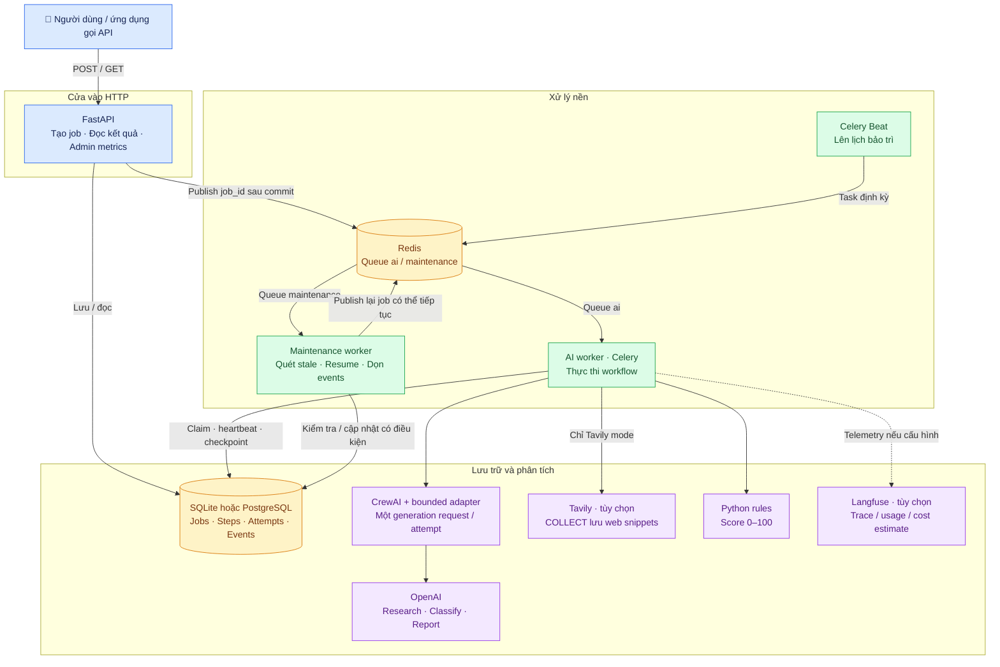
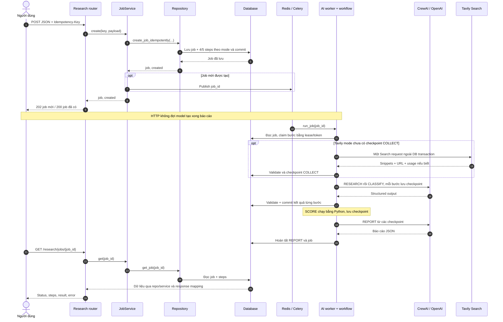
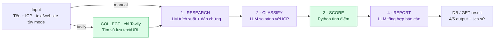
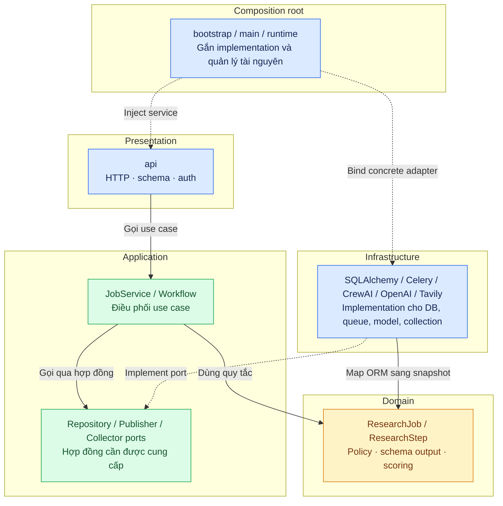
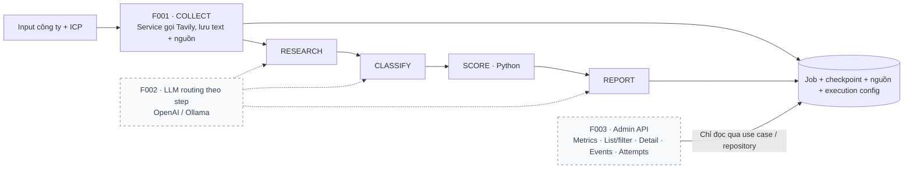

# Bản đồ hệ thống AI Company Research

Tài liệu này giải thích hệ thống từ góc nhìn người dùng, các service đang chạy và
các layer trong code. Đối chiếu code ngày **2026-10-18**. Các sơ đồ Mermaid có thể xem
trực tiếp bằng Markdown Preview có hỗ trợ Mermaid hoặc trên GitHub.

**Mục đích:** nhận thông tin một doanh nghiệp và chân dung khách hàng lý tưởng (ICP),
trích xuất dữ liệu, đánh giá độ phù hợp, chấm điểm và tạo báo cáo giúp sàng lọc lead.
Manual mode mặc định dùng text operator; Tavily mode thêm COLLECT để lưu nguồn web trước
phân tích. Xem [thu thập nguồn Tavily](tavily-collection.vi.md) để cấu hình và thử API.

## 1. Bản đồ các thành phần đang có

Mũi tên thể hiện lời gọi hoặc đường đi dữ liệu; DB lưu trạng thái nghiệp vụ chính.
Redis chuyển thông điệp công việc, không phải nơi lấy báo cáo cuối cùng.

| Thành phần | Làm gì? | Nhận → trả / lưu | Khi nào hoạt động? | Code hoặc cấu hình |
|---|---|---|---|---|
| FastAPI | Kiểm tra HTTP input, gọi use case, trả response | JSON → job_id hoặc dữ liệu job | Mỗi HTTP request | [main.py](../src/company_ai/main.py), [routers](../src/company_ai/api/router.py) |
| Research API | Tạo job, xem job/events, yêu cầu retry có bảo vệ | Input công ty + ICP → job và trạng thái | Người dùng gọi endpoint | [research/router.py](../src/company_ai/api/research/router.py) |
| Admin API | Hiện xem số lượng job/step/event, token và ước lượng chi phí | Bearer token → metrics | Người nội bộ gọi GET /metrics | [admin/router.py](../src/company_ai/api/admin/router.py) |
| Redis | Giữ và chuyển message để worker nhận việc | Message task có job_id → worker | Khi publish/consume task | [messaging.py](../src/company_ai/infrastructure/messaging.py) |
| AI worker | Nhận task và chạy tuần tự các bước research | job_id → checkpoint/result trong DB | Có task trong queue ai | [ai_tasks.py](../src/company_ai/tasks/ai_tasks.py) |
| Workflow | Chọn bước tiếp theo, claim quyền xử lý, kiểm tra checkpoint/budget/output | Job + bước trước → bước tiếp theo | Bên trong AI worker | [execute_workflow.py](../src/company_ai/application/research/execute_workflow.py) |
| CrewAI | Tổ chức agent/task dùng adapter bị giới hạn số call | Payload → output JSON từ LLM | Ba bước cần LLM | [crew_factory.py](../src/company_ai/infrastructure/research/ai/crew_factory.py) |
| OpenAI adapter | Gửi prompt/schema, đọc usage, chuẩn hóa lỗi | Messages/schema → kết quả có kiểu | Research/Classify/Report | [llm_adapter.py](../src/company_ai/infrastructure/research/ai/llm_adapter.py) |
| Tavily collector | Một Search request mỗi attempt, lưu text và URL chuẩn hóa | Tên/hostname → source checkpoint, warnings, credits nếu biết | COLLECT chỉ trong Tavily mode | [tavily.py](../src/company_ai/infrastructure/research/collection/tavily.py) |
| Score Python | Tính điểm theo quy tắc công khai | Research + classification → score/rule_breakdown | Bước SCORE, không gọi model | [scoring.py](../src/company_ai/domain/research/scoring.py) |
| Database | Lưu nguồn trạng thái nghiệp vụ, kết quả và lịch sử | Jobs, steps, attempts, events | API/worker/bảo trì đều truy cập | [models.py](../src/company_ai/infrastructure/research/persistence/models.py) |
| Celery Beat | Đặt lịch task bảo trì, không tự chạy phân tích | Lịch → message bảo trì | Theo cấu hình schedule | [celery_app.py](../src/company_ai/celery_app.py) |
| Maintenance worker | Quét bước hết lease, resume job pending, xóa event đủ điều kiện retention | DB state → cập nhật / enqueue | Nhận task queue maintenance | [maintenance_tasks.py](../src/company_ai/tasks/maintenance_tasks.py) |
| Migration | Cập nhật schema DB bằng Alembic | Migration revision → schema | Trước khi API/workers khởi động trong Compose | [Compose](../docker-compose.yml) |
| Langfuse | Quan sát từng step, call, token và chi phí ước lượng | Trace/span → hệ thống quan sát | Tùy chọn cấu hình/package | [telemetry](../src/company_ai/infrastructure/telemetry/) |

Trong Compose mặc định, Redis dùng kết nối ngoài theo env; Redis/PostgreSQL container
đi kèm là các profile tùy chọn. SQLite và PostgreSQL là hai lựa chọn backend, không
phải hệ thống tự ghi đồng thời vào cả hai.

## 2. Một request tạo job đi đâu?

| Giai đoạn | Việc xảy ra | Ý nghĩa đối với người dùng |
|---|---|---|
| Nhận input | Validate trường bắt buộc, URL, giới hạn độ dài | Input sai bị từ chối trước khi tạo công việc |
| Idempotency | Cùng key/payload trả job cũ; cùng key khác payload trả 409 | Gửi lặp request không chủ động tạo một job mới |
| Commit job | Lưu job và các steps trước publish | Có thể tra job ngay khi được chấp nhận |
| Publish | Gửi message sang Redis | Worker có thể nhận việc; nếu publish lỗi, pending recovery hỗ trợ tiếp tục |
| Chạy nền | Worker xử lý, HTTP request tạo job đã kết thúc | Dùng job_id để poll, không cần giữ HTTP chờ LLM |
| Checkpoint | Kết quả hợp lệ lưu sau mỗi bước | Resume tái sử dụng bước đã xong nếu hash khớp |
| Đọc kết quả | GET đọc DB, không chạy lại workflow | Xem lại job không gọi model hoặc phát sinh generation mới |

Sơ đồ rút gọn đường trả dữ liệu từ DB về API; trong code dữ liệu vẫn lần lượt đi
qua repository, service rồi router. Không có chuyện DB trực tiếp trả HTTP response.

## 3. Bản đồ các bước thu thập và phân tích

| Bước | Dữ liệu chính đọc vào | Làm gì? | Output chính | Kiểm tra quan trọng |
|---|---|---|---|---|
| COLLECT (Tavily) | Tên, hostname website nếu có và policy version; không có ICP | Lưu tối đa 5 nguồn, 4.000 ký tự/nguồn, 20.000 tổng ký tự | Query, source IDs/text/URL, warnings, reported usage | Một request/attempt; checkpoint và counter riêng, không là LLM call |
| RESEARCH | company_name, text operator; Tavily thêm effective sources | Trích ngành, sản phẩm, nhóm khách hàng, đoạn bằng chứng và giới hạn | industry, products, customer_segments, evidence, limitations; Tavily thêm evidence_sources | Quote nguyên văn trong text; Tavily kiểm tra source ID và từng source content |
| CLASSIFY | Research checkpoint + ICP | Nhận định phù hợp và thông tin thiếu | icp_match, matching_signals, missing_signals, reasoning | Tín hiệu phải dựa trên evidence Research; ICP không là bằng chứng công ty |
| SCORE | Research + Classify | B2B/SaaS 40, ICP fit 30, SME 20, sản phẩm rõ 10 | score, qualification, rule_breakdown | Deterministic Python; HIGH ≥70, MEDIUM ≥40, còn lại LOW |
| REPORT | Input công ty và các checkpoint đã có | Viết tóm tắt, điểm mạnh, rủi ro và câu hỏi tiếp theo | executive_summary, strengths, risks, next_questions, sources_note; Tavily thêm sources/limitations | JSON/schema, URL đúng checkpoint, operator URL null; giữ giới hạn và không khẳng định xác minh độc lập |

Manual mode giữ URL website làm metadata. Tavily mode dùng hostname để tìm nguồn,
chỉ lưu snippet provider trả về, không trực tiếp tải trang; các bước LLM dùng OpenAI.
Scoring còn thiên về từ khóa tiếng Anh. Kiểm tra quote chứng minh nguồn văn
bản, không chứng minh doanh nghiệp thực tế đúng như văn bản nói. REPORT không có bộ
kiểm tra độc lập bảo đảm mọi câu do model viết đều đúng sự thật.

## 4. Bản đồ DDD trong source code

DDD tổ chức code theo nghiệp vụ và trách nhiệm. Các layer là các phần của code,
không có nghĩa phải triển khai mỗi layer thành một container riêng.

Mũi tên liền mô tả việc sử dụng/gọi trong thiết kế; nét đứt là implementation hoặc
wiring. Khi chạy, application gọi method trên một object repository thật đã được
inject. Chiều gọi runtime có thể tới infrastructure, nhưng application chỉ import
port; nó không import class SQLAlchemy. Đây là điểm đảo chiều phụ thuộc quan trọng.

| Layer | Cách hiểu dễ nhớ | Ví dụ thực tế | Không nên làm ở đây |
|---|---|---|---|
| API | Quầy nhận/trả yêu cầu HTTP | Parse JobInput, lấy header, response_model | Viết SQL, tự chấm điểm, gọi OpenAI trực tiếp |
| Application | Người điều phối công việc | Tạo job rồi publish; claim → gọi model → validate → checkpoint | Import ORM để tự truy vấn hoặc nhét quy tắc vào router |
| Domain | Luật nghiệp vụ và dữ liệu có ý nghĩa | Retry candidate, evidence policy, score, ResearchJob | Phụ thuộc FastAPI/Redis/CrewAI/SQLAlchemy |
| Infrastructure | Cách kết nối công nghệ cụ thể | Query DB, publish Celery, gọi model | Để ORM lọt ra ngoài thay snapshot hoặc viết lại business policy |
| Bootstrap | Nơi lắp các bộ phận vào nhau | Bind get_research_repository sang SQLAlchemy adapter | Tự thực thi nghiệp vụ trong lúc tạo dependency |

### Một ví dụ DI cụ thể

| Thứ tự | Hàm / object | Làm gì? |
|---|---|---|
| 1 | Router yêu cầu `Jobs` | FastAPI thấy alias Annotated có Depends(get_job_service) |
| 2 | get_job_service | Cần repository port và publisher port để tạo JobService |
| 3 | configure_dependencies | Đã đăng ký concrete provider thay cho contract dependency |
| 4 | get_sqlalchemy_research_repository | Nhận AsyncSession của request, tạo repository adapter |
| 5 | JobService.get | Gọi repo.get_job khi handler cần đọc job |
| 6 | Repository | Query DB rồi trả ResearchJob/ResearchStep snapshots |
| 7 | Router | Map snapshot sang JSON response |

Xem [API dependency contracts](../src/company_ai/api/research/dependencies.py) và
[bootstrap bindings](../src/company_ai/bootstrap/dependencies.py).
`Depends` lắp object; nó không có nghĩa constructor tự chạy SQL. API lifespan tạo
engine/client; mỗi request có session riêng. Worker có lifecycle khác: task đồng bộ
Celery được nối vào async loop và dispose engine trước khi đóng loop, xem
[runtime.py](../src/company_ai/runtime.py).

## 5. Dữ liệu và cơ chế bảo vệ workflow

| Khái niệm | Hiểu đơn giản | Tránh vấn đề gì? |
|---|---|---|
| Job | Một yêu cầu đánh giá doanh nghiệp | Gom input, trạng thái và kết quả của một lần đánh giá |
| Step | Một công đoạn của job | Biết job đang dừng ở Collect (nếu có), Research, Classify, Score hay Report |
| Attempt | Một lần thử thực hiện step | Theo dõi số lần chạy, request ID, token, lỗi và chi phí |
| Event | Mốc audit bền vững trong DB | Lần theo claim, bắt đầu request, checkpoint, lỗi và recovery |
| Claim | Giành quyền xử lý step bằng cập nhật nguyên tử | Hạn chế hai worker cùng nhận quyền chạy một bước |
| Lease | Quyền xử lý có thời hạn | Worker chết không giữ quyền vĩnh viễn |
| Heartbeat | Worker gia hạn lease khi còn làm việc | Bước lâu không bị coi là mất worker chỉ vì chưa xong |
| Fencing token | Mã quyền sở hữu được kiểm tra lúc ghi kết quả | Worker cũ/hết lease không ghi đè kết quả mới |
| Checkpoint | Output bước đã validate và commit | Resume dùng lại kết quả hoàn thành thay vì gọi model lại |
| Input/output hash | Dấu nhận diện payload, cấu hình và output | Phát hiện checkpoint sai phiên bản hoặc dữ liệu không còn khớp |
| Budget reservation | Giữ trước chi phí ước lượng trước request | Giới hạn theo policy; không phải billing ledger/hard cap provider |
| NEEDS_REVIEW / UNKNOWN | Kết quả cần người xem lại, có thể chưa biết request đã chạy chưa | Tránh retry model âm thầm gây tính phí trùng |

Không bảo đảm exactly-once invocation/billing với provider. Ví dụ provider đã trả kết
quả nhưng worker crash trước commit: DB chưa có checkpoint, nhưng request có thể đã
được tính phí. Đây là lý do các ca mơ hồ không được tự retry LLM hoặc COLLECT.

## 6. Hiện tại và lộ trình F001–F003

F001 đã triển khai dưới dạng mode tùy chọn; F002/F003 trong sơ đồ vẫn là thiết kế dự kiến.

| Phần | Hiện có | Dự kiến bổ sung | Đặc tả |
|---|---|---|---|
| Thu thập nguồn | Manual bốn bước; Tavily mode có COLLECT trước Research, lưu text/URL và checkpoint | F001 đã triển khai; chưa có crawler trực tiếp hoặc deep research | [F001](../features/F001-tavily-collection.md), [vận hành](tavily-collection.vi.md) |
| Provider LLM | Ba bước LLM gọi OpenAI | Profile/provider/model từng step, ví dụ Report dùng Ollama; snapshot cấu hình theo job | [F002](../features/F002-per-step-llm-providers.md) |
| Admin | GET /api/v1/admin/metrics có Bearer token | List/filter/detail/events/attempts, API qua Swagger/Postman; docs/admin theo từng layer | [F003](../features/F003-admin-api-ddd.md) |

F003 vẫn thuộc nghiệp vụ research; không cần tạo domain admin riêng chỉ vì có router
admin. Khi triển khai, các tài liệu từng layer trong docs/admin sẽ bổ sung walkthrough
chi tiết theo code cuối cùng. Bản đồ này không thay thế các đặc tả feature.

## 7. Nên đọc tiếp ở đâu?

| Bạn muốn hiểu gì? | Tài liệu |
|---|---|
| Setup và thử API | [README tiếng Việt](README.vi.md) |
| Thu thập nguồn, provenance và recovery Tavily | [Tavily collection](tavily-collection.vi.md) |
| Luồng thực thi và xử lý tình huống | [End to end](end-to-end.vi.md) |
| DDD, DI, async và database | [Kiến trúc](architecture.vi.md) |
| Các container/service và lệnh Compose | [Compose services](compose-services.vi.md) |
| Failure matrix và kiểm chứng | [Verification](verification.md) |
| Kế hoạch phát triển tiếp | [Features index](../features/README.md) |
